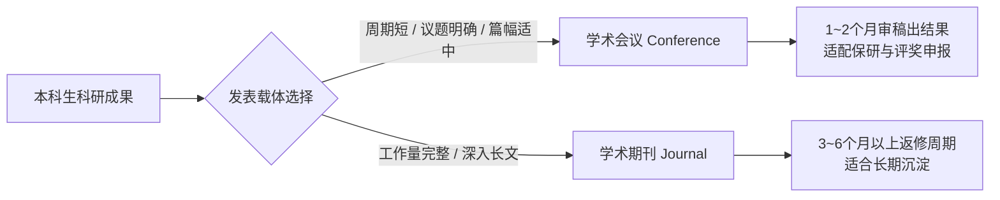
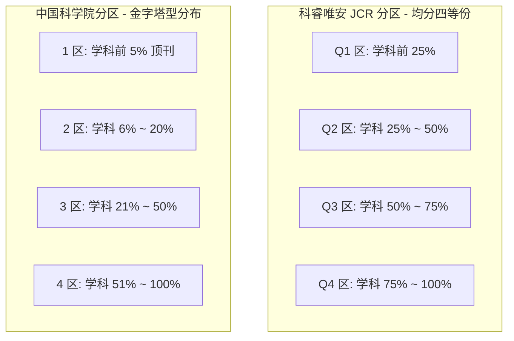
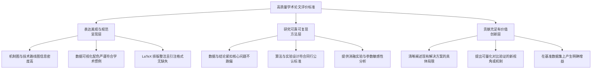
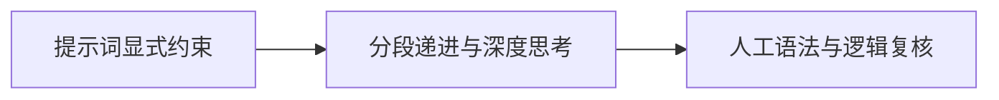
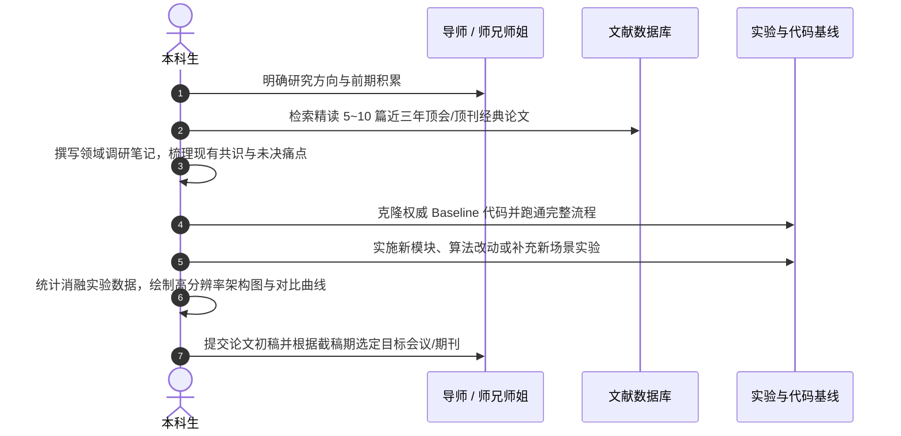

# 📚 本科生科研全流程指南：从名词辨析到论文发表

> 本指南系统梳理本科生开展学术研究的必备常识，涵盖论文与期刊概念、发表载体选型、权威索引机制、好论文评判标准、查重与降 AI 率技巧以及进组落地清单。

---

## 1. 概念透析：论文、期刊与综述

### 1.1 论文与期刊的本质

- **学术论文（Academic Paper）**：围绕特定的科学或工程问题，运用严谨的方法与实证数据进行探索，记录“问题背景、研究方案、实验验证、新认知与结论”的学术成果。
- **学术期刊（Academic Journal）**：由学术出版社或专业学会定期出版、经过同行评审（Peer Review）把关的学术文献集刊。高校与科研机构通常统一购买期刊数据库的订阅权限，而非单独购买学者个人的论文。

### 1.2 研究论文与综述论文的区别

| 比较维度 | 研究论文（Research Paper） | 综述论文（Review Paper） |
| :--- | :--- | :--- |
| **形象比喻** | **经实验验证的新菜谱** | **系统梳理与点评的领域菜单** |
| **核心内容** | 阐述实验材料、方法设计、原始数据、对比结果及改进发现 | 全面检索、归纳并横向比对某细分领域已有的全部代表性成果 |
| **侧重点** | 阐明“具体通过何种新方法达成了何种新突破” | 梳理学术界共识、现有技术瓶颈、学派争议及未来探索方向 |
| **适合阶段** | 拥有独立算法/实验数据、明确创新点与消融验证时 | 刚进组建立领域认知、文献调研阶段 |

> 💡 **为什么导师往往让新手“先写一篇综述”？**
> 本科生独立开展科研通常遵循三个阶段：**海量文献精读 $\rightarrow$ 理解领域边界与知识空白 $\rightarrow$ 寻找切实切入点**。撰写综述能强迫阅读并提炼几十篇经典与前沿文献，快速构建该领域的知识谱系。

---

## 2. 会议论文 vs 期刊论文：本科生发表与选择策略

### 2.1 会议论文对本科生的三大优势

1. **选题难度相对较低（明确的议题范围）**：会议发布征稿通知（Call for Papers, CFP）时会列出具体议题方向，结合课题组现有积累容易锁定切入点。
2. **篇幅与工作量要求友好**：会议论文通常有严格页数限制（常规为 4~8 页），相比动辄数十页的期刊长文，对初期实验积累量较轻的本科生更为可行。
3. **审稿周期短，适配保研与评优时间节点**：
   - **学术会议**：截稿日期固定，审稿人集中评阅，通常 1~2 个月出具录用通知（Acceptance Notification）。
   - **学术期刊**：稿件匹配专家耗时较长，通常经历 1~3 轮返修（Major/Minor Revision），全流程耗时 3~6 个月甚至更久，容易错过推免申报窗口。

### 2.2 计算机学科（CS）特例与权威认可机制

- **常规学科模式**：在机械、材料、化学、生物等基础理工科中，高水平学术期刊（尤其是 SCI 一区顶刊）享有最高学术认可度，学术会议多作交流汇报之用。
- **计算机学科反转**：计算机与人工智能领域迭代极其迅速，传统期刊数月至数年的审稿周期无法满足技术前沿传播需求。因此，**中国计算机学会（CCF）评定的 CCF-A 类顶级国际学术会议（简称“顶会”），其含金量、学术声誉与录取难度普遍高于普通期刊**。
  - *代表性顶会*：CVPR、ICCV、ECCV（计算机视觉）；NeurIPS、ICML、ICLR（机器学习）；ACL、EMNLP（自然语言处理）；KDD（数据挖掘）；AAAI、IJCAI（综合人工智能）。

---

## 3. 权威学术索引、影响因子与分区机制

### 3.1 主流学术索引速查表

> 🔍 **什么是“索引（Index）”？**
> 由国内外权威评价机构对学术出版物进行质量评估后建立的检索数据库。成果被权威索引收录，通常作为学术评价的准入门槛。

| 索引名称 | 全称 / 主办机构 | 覆盖领域 | 学术定位 |
| :--- | :--- | :--- | :--- |
| **SCI / SCIE** | Science Citation Index Expanded (科睿唯安) | 自然科学、工程技术、医学等 | 全球自然科学核心引文数据库 |
| **EI Compendex** | Engineering Index (爱思唯尔) | 工程技术各个学科 | 全球顶尖工程类综合引文库 |
| **SSCI** | Social Sciences Citation Index (科睿唯安) | 经济学、管理学、法学、社会学等 | 全球社会科学顶尖索引 |
| **A&HCI** | Arts & Humanities Citation Index (科睿唯安) | 艺术、历史、哲学、文学等 | 人文与艺术领域国际索引 |
| **CCF 推荐目录** | 中国计算机学会推荐国际会议与期刊目录 | 计算机体系结构、软件工程、AI 等 | 国内计算机专业认定核心标准 (A/B/C) |
| **北大核心** | 中文核心期刊要目总览 (北京大学图书馆) | 综合性全学科中文期刊 | 国内学术评价广泛采用的中文期刊标准 |
| **CSSCI** | 南京大学中国社会科学研究评价中心 (南大核心) | 人文与社会科学中文期刊 | 国内社科领域权威学术评价标准 |
| **CSCD** | 中国科学引文数据库 (中国科学院文献情报中心) | 自然科学与工程中文期刊 | 国内理工科权威中文核心索引 |

### 3.2 影响因子（Impact Factor, IF）计算公式与物理意义

影响因子反映期刊刊载论文在特定时限内的被引用频率：

$$\text{JIF}_Y = \frac{\text{该期刊在 } Y-1 \text{ 与 } Y-2 \text{ 年发表的所有论文在第 } Y \text{ 年被引用的总次数}}{\text{该期刊在 } Y-1 \text{ 与 } Y-2 \text{ 年发表的可引用论文总数}}$$

- **引用的本质**：知识从前期成果向前沿成果的流动与扩散，反映同行的关注度与学术影响力。
- **跨学科不可比性**：
  - *高引用学科*：生物医药、肿瘤学、材料科学实验周期短、发文量大，期刊影响因子往往在 10 至数十以上。
  - *低引用学科*：数学、理论计算机、考古学研究周期长、成果沉淀慢，期刊影响因子在 1~3 之间同样属于学科顶级期刊。

### 3.3 SCI 期刊分区机制对比：JCR 分区 vs 中科院分区

为消除不同学科影响因子绝对值悬殊的偏差，学术界通过“学科内相对位次百分比”对期刊进行分级：

- **JCR 分区（科睿唯安官方）**：将学科内所有期刊按 IF 降序均分为 4 个等分区间，每个区间各占 25%（Q1 ~ Q4）。
- **中科院分区（国内高校/院所评审基准）**：采用金字塔型分级，**1 区仅保留学科头部前 5% 的顶级刊物**，2 区占 6%~20%，在国内保研加分、评奖评优中更具区分度和硬核效力。

---

## 4. 判断一篇好论文的三大金标准

发表学术论文并不要求颠覆基础物理学或从零提出全新学科体系。科学探索的常态是在现有共识基础上，**补充一份可信实验证据、揭示一段微观机理，或改进一个工程瓶颈**。

### 4.1 三大维度的具体要求

1. **表达美观（呈现层）**：
   - 包含专业的技术路线图（Framework）或原理机制图（Workflow），降低审稿人的理解成本。
   - 图表使用学术界通用的调色盘，轴标签、图例、误差棒（Error Bar）完整规范。
   - 公式推导符号统一，参考文献字段完整，避免出现抓取不全的脏数据。
2. **研究可靠（方法层）**：
   - **回应性**：实验测试的数据直接解答论文引言中提出的核心研究假设，杜绝“为实验而实验”的脱节现象。
   - **严谨性**：基线方法（Baseline）选取近两年公认的主流方案，参数设置公平对齐，代码与实验随机种子公开可复现。
3. **贡献充足（价值层）**：
   - 交代如果不攻克该问题会产生何种痛点，攻克后能为学术界或产业界提供何种借鉴。
   - 通过消融实验（Ablation Study）明确证明所引入的每一个新模块或参数在提升效果中承担的作用。

> 🤖 **AI 时代的新趋势**
> 随着大语言模型和绘图工具的普及，排版修辞与制图门槛已被显著拉低。科研的核心竞争点回归底层构思：**能否在学术共同体关注的前沿领域中，提炼出一个兼具科学价值与解决空间的“好问题”**。

---

## 5. 论文查重、润色与降低 AI 检出率实战

### 5.1 查重机制与主流检测工具

- **国内高校定稿基准**：知网（CNKI）学术不端文献检测系统、万方相似度检测系统、维普检测。
- **初稿自查与预演渠道**：
  - **学习通 / 大雅查重**：可通过在“超星学习通”建立测试班级，通过提交作业形式免费调用大雅查重系统出具重复率分析报告。大雅检测标准相对严格，适合前期多轮改写降重。
  - **定稿要求**：通过初查后，最终必须使用学校指定的正式系统（通常为知网 VIP / PMLC 系统）生成最终盖章报告。

### 5.2 降低论文 AI 检出率的 3 个实操方法

1. **Prompt 显式约束**：在要求模型协助润色或生成学术文本时，加入硬性行文约束。
   - *提示词示例*：“请修改以下段落，保持学术严谨性，禁止使用‘毫无疑问’、‘显而易见’、‘总而言之’等模版化过渡词；句式结构采用长短句结合，严禁包含多余的免责声明，严格遵守科技论文客观叙述规范。”
2. **分段投喂 + 深度思考重写**：
   - 避免将整篇万字论文一次性输入模型。
   - 按章节与段落进行拆解，将核心逻辑点列出，借助具备深度推理能力的大模型重构句法结构，消除句首特征词汇与机械并列句式。
3. **规范自动化生成辅助**：结合学术排版工具与查重平台（如 yizipaper、知序 KnowLine）辅助规范参考文献与格式，重点把控个人实验数据与论证逻辑的核心原创性。

---

## 6. 本科生科研进组与起步 Checklist

### 6.1 进组准备度评估自检

- [ ] **文献阅读基础**：是否能够流畅阅读本领域 IEEE / ACM / Springer 等英文期刊与会议论文，并准确提炼 Abstract 与 Methodology？
- [ ] **工程与实验基础**：是否掌握至少一门主流开发语言（如 Python / C++），并熟练搭建 Conda 虚拟环境、PyTorch / TensorFlow 等常用框架？
- [ ] **版本控制与工具链**：是否熟悉 Git 基本操作，能够独立克隆前人开源代码库并在本地或服务器复现基线结果？
- [ ] **目标明晰度**：进组目标是争取推免保研加分、丰富海外留学文书，还是探索读研深造意向？

### 6.2 课题落地推进路线图

