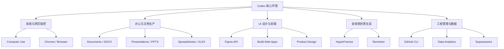
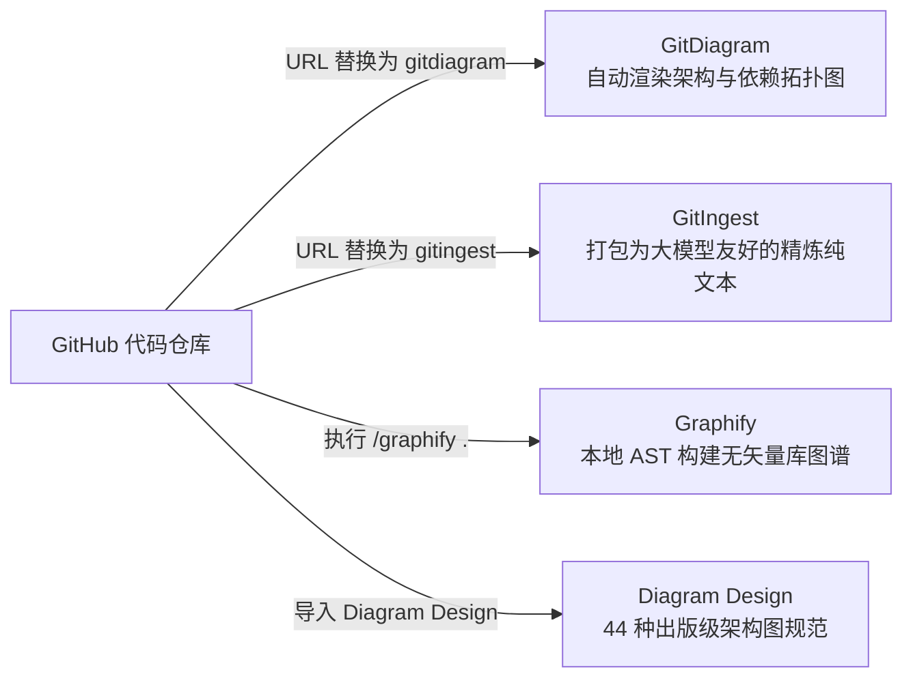
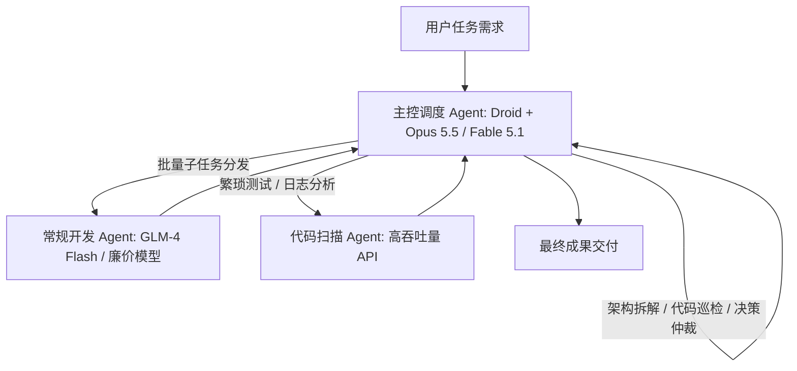
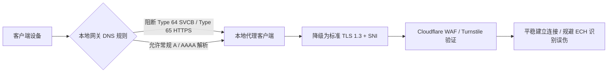

# 🤖 AI Agent 与 Skills 生态体系深度指南

> 本指南汇总了面向开发、科研、多媒体制作与游戏工程的 AI Agent 实用技能（Skills）、核心插件生态、多智能体协同架构以及网络风控防护策略。

---

## 1. 全球热门通用与开发 Skills TOP 10（skills.sh 生态）

根据 [skills.sh](https://www.skills.sh) 开发者生态权威统计，主流 Coding Agent 高频调用的通用能力如下：

| 排名 | Skill 名称 | 分类标签 | 历史安装量 | 核心能力与适用场景 | 常用触发场景 / 指令示例 |
| :---: | :--- | :---: | :---: | :--- | :--- |
| **01** | `find-skills` | Agent | 约 3.7M | **生态能力检索**：在执行陌生或复杂任务前，在生态索引库中检索并匹配最适配的 Skill。 | `先帮我检索适合处理音视频剪辑的技能包` |
| **02** | `grill-me` | Planning | 约 1.3M | **多维连续追问**：围绕目标、约束、边界与细节连续发问，将模糊构想拆解为清晰的落地 PRD。 | `请像严格的产品总监一样对我连环追问` |
| **03** | `grill-with-docs` | Docs | 约 1.1M | **文档盲区排查**：依据现有文档或代码上下文进行定向核对，审查潜在逻辑漏洞与暗病。 | `结合接口文档，审查方案中的边界条件缺陷` |
| **04** | `improve-codebase-architecture` | Code | 约 1.0M | **架构全貌诊断**：审视模块边界、依赖耦合度与设计模式缺陷，生成重构路径与模块解耦方案。 | `诊断当前项目的模块耦合情况并给出解耦方案` |
| **05** | `tdd` | Test | 约 1.0M | **测试驱动开发**：严格遵循“先写红灯失败测试 $\rightarrow$ 最小化实现转绿 $\rightarrow$ 重构”流程。 | `使用 TDD 模式重构用户鉴权与 Token 刷新逻辑` |
| **06** | `agent-browser` | Browser | 约 950K | **浏览器自动化操作**：赋予 Agent 控制无头/有头浏览器进行网页点击、填表、翻页与数据采集能力。 | `打开目标网页并提取表格中的全部价格数据` |
| **07** | `frontend-design` | Design | 约 920K | **去模板味前端设计**：跳出套路化的通用后台模板，优化色彩层级、排版留白与高辨识度质感。 | `为该落地页设计具有现代设计感与微动效的界面` |
| **08** | `setup-matt-pocock-skills` | Setup | 约 890K | **工程技能组合包**：一键配置 Matt Pocock 的成套工程工作流规则、TypeScript 最佳实践。 | `一键初始化团队 TypeScript 研发规则` |
| **09** | `handoff` | Workflow | 约 870K | **跨会话上下文交接**：自动整理已完成项、当前进展、待办事项与技术决策，支持跨会话无缝接力。 | `生成交接上下文，准备切换到新模型继续执行` |
| **10** | `triage` | Issues | 约 840K | **缺陷与工单定级**：自动化分类与评估 GitHub Issue，辨别轻重缓急并输出行动指南。 | `对待办 Issue 进行优先级分级并建议负责人` |

> 🛡️ **安全试用三步原则**：
> 1. **核对来源**：确认 GitHub 组织官方认证或高星开发者维护；
> 2. **权限审计**：检查 Skill 声明的 Bash / 文件读写与网络权限；
> 3. **沙箱隔离**：先在低风险仓库或只读模式中验证其实际运行行为。

---

## 2. Codex 必装 14 个高频插件与能力扩展

1. **系统与网页操控**：
   - `Computer Use`：提供桌面 GUI 操控、鼠标点击与键盘输入能力；
   - `Chrome / Browser`：联动本地 Chrome 浏览器，支持会话保持与网络交互。
2. **办公与文档处理**：
   - `Documents`：规范处理长篇技术文档、Markdown 与 Word 格式转换；
   - `Presentations`：自动化生成排版优良的幻灯片（PPTX）；
   - `Spreadsheets`：进行多维表格、公式计算与数据透视。
3. **设计与前端研发**：
   - `Figma`：直接读取 Figma 画布组件结构、Tokens 与布局尺寸，降低设计还原偏差；
   - `Build Web Apps`：端到端原型快速构建，先呈现视觉参考再生成高质量代码；
   - `Product Design`：梳理用户旅程、业务流程图并生成线框原型。
4. **视频与创意生产**：
   - `HyperFrames`：将 HTML/CSS 动画与 DOM 结构无损渲染为高质量 MP4 演示视频；
   - `Remotion`：基于 React 组件编写代码化视频，适用于批量短视频与动态图表制作。
5. **数据与工作流管理**：
   - `Data Analytics`：进行统计建模、假设检验与科学数据可视化；
   - `GitHub`：拉取 PR、管理 Issue、审查代码与工作流自动化；
   - `Superpowers`：扩展任务拆解、并行代理调用与会话管理能力。

---

## 3. GitHub 科研全流程 Skills TOP 10 详解

针对学术研究从选题到定稿、答辩的完整闭环，全球开源社区构建了成熟的科研技能生态：

| 排名 | 技能包名称 | 官方 GitHub 仓库 | Stars | 核心定位与最适配场景 |
| :---: | :--- | :--- | :---: | :--- |
| **TOP 1** | **Academic Research Skills (ARS)** | [`Imbad0202/academic-research-skills`](https://github.com/Imbad0202/academic-research-skills) | 49.9k ★ | **论文全流程管理**：从文献调研、初稿草拟、同行审稿回复到返修润色一站式闭环。 |
| **TOP 2** | **Scientific Agent Skills** | [`K-Dense-AI/scientific-agent-skills`](https://github.com/K-Dense-AI/scientific-agent-skills) | 47.2k ★ | **综合科研与科学计算**：集成 PubChem、ChEMBL 等 100+ 数据库与 177 个科研计算技能，面向生化材料医学。 |
| **TOP 3** | **Nature Skills** | [`Yuan1z0825/nature-skills`](https://github.com/Yuan1z0825/nature-skills) | 45.3k ★ | **高水平论文表达**：专为 Nature / Science 级别的学术英语修辞、图解摘要（Graphical Abstract）与期刊规范适配。 |
| **TOP 4** | **Auto-claude-code-research-in-sleep (ARIS)** | [`wanshuiyin/Auto-claude-code-research-in-sleep`](https://github.com/wanshuiyin/Auto-claude-code-research-in-sleep) | 16.8k ★ | **自动化自主科研流程**：纯 Markdown 轻量化技能，实现无人值守的假设生成、交叉评审循环与实验自动化推进。 |
| **TOP 5** | **AI-Research-SKILLs** | [`Orchestra-Research/AI-Research-SKILLs`](https://github.com/Orchestra-Research/AI-Research-SKILLs) | 13.1k ★ | **AI / ML 科研项目**：面向深度学习算法研究，打通数据预处理、模型训练微调、评测与论文写作全链条。 |
| **TOP 6** | **Academic Research Skills Codex** | [`Imbad0202/academic-research-skills-codex`](https://github.com/Imbad0202/academic-research-skills-codex) | 11.9k ★ | **Codex 原生工作流**：针对 Codex 环境优化的学术研究、代码复现与 Human-in-the-loop 交互设计。 |
| **TOP 7** | **Hamuleite** | [`hoochanlon/hamuleite`](https://github.com/hoochanlon/hamuleite) | 9.8k ★ | **学术资源聚合库**：大型学术资源检索入口，涵盖学术文献、开放教材、金融研报与跨学科知识索引。 |
| **TOP 8** | **Figures4Papers** | [`ChenLiu-1996/figures4papers`](https://github.com/ChenLiu-1996/figures4papers) | 7.8k ★ | **科研绘图与可视化**：包含大量顶刊顶会级别的 Python 绘图源码脚本，支持热图、森林图与高密度图表。 |
| **TOP 9** | **Supervisor-Skills** | [`HKUSTDial/Supervisor-Skills`](https://github.com/HKUSTDial/Supervisor-Skills) | 7.7k ★ | **博士生科研训练（AI副导师）**：香港科技大学团队研发，将博导十年科研经验提炼为结构化辅导提示与路线图。 |
| **TOP 10** | **Research Paper Writing Skills** | [`Master-cai/Research-Paper-Writing-Skills`](https://github.com/Master-cai/Research-Paper-Writing-Skills) | 7.2k ★ | **论文写作规范强化**：源自彭斯达教授学术写作笔记，深度适配机器学习与计算机视觉领域的英文论文成稿。 |

### 3.1 进阶科研专项技能扩展

- **学术可视化与制图**：
  - `scipilot-figure-skill`：通用科研制图代码生成，内置顶刊合规自检与配色校正；
  - `Paper Craft Skills`：论文可视化与排版套件，一键生成期刊方法原理图；
  - `academic-figure-skill`：生信专项绘图，适配单细胞、转录组等组学热图与火山图；
  - `academic figure generator`：上传正文自动提取核心机制并输出排版提示词。
- **论文去 AI 痕迹与逻辑加固**：
  - `anti defensive writing skill`：剔除 AI 常见的多余免责声明、含糊用语与套话，让观点明确客观；
  - `PaperSpine`：梳理实验数据与论据因果链条，反推审稿人视角的薄弱环节；
  - `Deep Research Skill`：8 阶段企业级文献证据链核验，确保引注真实可查。
- **知识沉淀与管理平台**：
  - **知序 KnowLine** ([`huashu996/KnowLine`](https://github.com/huashu996/KnowLine))：下一代开源科研知识管理平台，融合可视化图谱与 AI 交互。

---

## 4. 代码知识图谱与架构全貌工具

在接手复杂陌生代码库时，传统方式往往因上下文长度溢出或盲目搜索导致认知偏差。业界推荐工具方案如下：

1. **GitDiagram** ([`ahmedkhaleel2004/gitdiagram`](https://github.com/ahmedkhaleel2004/gitdiagram) / [gitdiagram.com](https://gitdiagram.com))：
   - *用法*：将 GitHub 仓库链接中的 `github.com` 替换为 `gitdiagram.com`；
   - *功能*：自动化生成项目架构图与模块依赖拓扑，直观展现系统调用流向。
2. **GitIngest** ([`coderamp-labs/gitingest`](https://github.com/coderamp-labs/gitingest) / [gitingest.com](https://gitingest.com))：
   - *用法*：将仓库 URL 中的 `github.com` 替换为 `gitingest.com`；
   - *功能*：自动过滤无用二进制文件，汇总目录树并提炼核心代码文本，大幅节约 Token。
3. **Graphify** ([`Graphify-Labs/graphify`](https://github.com/Graphify-Labs/graphify))：
   - *定位*：本地确定性 AST 解析，将代码、SQL 结构、配置与说明文档压缩为结构化知识图谱；
   - *执行命令*：`$ /graphify .`，生成包含 `graph.html` 交互图与 `GRAPH_REPORT.md` 的知识报告。
4. **Diagram Design** ([`cathrynlavery/diagram-design`](https://github.com/cathrynlavery/diagram-design))：
   - *定位*：为 Claude Code、Codex、Cursor 定制的 44 种高质感架构图模版，直接生成自包含的 HTML + SVG，无冗余阴影。

---

## 5. 视频创作与剪辑 Skills TOP 10

| 排名 | Skill 名称 | 核心定位与功能 | GitHub 仓库 / 热度 |
| :---: | :--- | :--- | :---: |
| **01** | `MoneyPrinterTurbo` | 自动化短视频生产线：文案生成、素材抓取、配音合成至字幕压制全流程自动化 | [`harry0703/MoneyPrinterTurbo`](https://github.com/harry0703/MoneyPrinterTurbo) (122k+ ★) |
| **02** | `OpenCut` | 剪映（CapCut）开源替代方案，提供轻量便捷的网页端多轨音视频剪辑体验 | [`OpenCut-app/OpenCut`](https://github.com/OpenCut-app/OpenCut) (89k+ ★) |
| **03** | `Remotion` | 声明式代码视频框架，采用 React 组件编排时间轴，生成出版级动态视频 | [`remotion-dev/remotion`](https://github.com/remotion-dev/remotion) (59k+ ★) |
| **04** | `OpenMontage` | 全流程数字制片工作室，打通剧本分镜、素材资产调度与成品自动化渲染 | [`calesthio/OpenMontage`](https://github.com/calesthio/OpenMontage) (57k+ ★) |
| **05** | `HyperFrames` | 渲染器，将前端 HTML/CSS 关键帧动画无损导出为高清 MP4 视频 | [`heygen-com/hyperframes`](https://github.com/heygen-com/hyperframes) (49k+ ★) |
| **06** | `Pixelle-Video` | 主题一键成片，仅需输入主题即自动匹配脚本、画面素材与背景音乐配音 | 28.0k ★ |
| **07** | `video-use` | 口播剪辑助手，自动识别实拍视频中的静音、气口与无效片段并生成粗剪样片 | 24.7k ★ |
| **08** | `video-shotcraft` | 分镜设计器，根据电影级运镜法则自动规划景别、轴线与视觉节奏 | 8.1k ★ |
| **09** | `seedance2-skill` | 视频大模型提示词库，针对 Seedance 等生成模型优化分镜运动提示词 | 3.6k ★ |
| **10** | `chengfeng-videocut-skills` | 面向中文创作者定制的自动加字幕、语音转写与短视频切片工作流 | 3.0k ★ |

---

## 6. Codex 游戏开发与逆向分析工具链

### 6.1 游戏开发 10 大 Skills 架构分层

1. **游戏生成与启动层**：
   - `higgsfield-game-generation`：游戏原型快速生成专用（高装机量）；
   - `game-engine`：通用游戏引擎，提供物理碰撞、重力模拟等底层架构；
   - `develop-web-game`：OpenAI 官方维护的 WebGL / Canvas 网页轻量小游戏套件。
2. **联机手感与 UI 交互层**：
   - `multiplayer-game`：基于 Rivet 提供房间匹配与多人实时状态同步；
   - `game-feel`：手感调优专长，涵盖打击停顿（Hitstop）、屏幕震动、粒子迸发与动态音效反馈；
   - `game-ui-design` / `game-ui-ux`：HUD 界面、血条状态、背包与菜单布局；
   - `threejs-game-ui-designer`：Three.js 专属 3D 界面适配。
3. **玩法理论与数值设计**：
   - `game-design-theory`：核心玩法循环（Core Gameplay Loop）、数值平衡曲线与成就奖励机制；
   - `game-developer`：全流程通用游戏开发综合辅助。

### 6.2 逆向工程与系统扩展

- **Eleven** ([`Zfinix/eleven`](https://github.com/Zfinix/eleven))：专为 Agent 打造的跨平台逆向工程套件，支持 Mac/iOS、Linux ELF、Windows PE 与 Android APK，能够联动 Agent 直接重命名变量、反编译函数并分析 GGUF / Safetensors 模型权重。
- **REA** ([`morluto/rea`](https://github.com/morluto/rea))：二进制分析与应用程序逆向库。
- **Hindsight** ([`vectorize-io/hindsight`](https://github.com/vectorize-io/hindsight))：自学习型智能体记忆系统，将观察提炼为去重信念，维护常驻心智模型。
- **Tendedero** ([`alejandrobujan/tendedero`](https://github.com/alejandrobujan/tendedero))：0.7MB 原生 macOS 开源“晒衣绳”截图工具，无网络权限，拖拽即用。
- **dsh-better-sidebar**：DSH 侧边栏工作台插件，集成代码查看、内置终端与 Sub-Agent 调用。
  - *安装命令*：`dsh plugin --profile web add dsh-better-sidebar`

---

## 7. 多 Agent 协同、性价比选型与网络防封策略

### 7.1 Droid 与 Orca 多 Agent 协同架构

针对 Claude 官方订阅封禁风险，开发者常采用 **Droid**（自建美区通道）配合 **Orca** 平台进行主次多智能体分工：

- **选型性价比梯度**：
  - *20 刀档*：高性价比，搭配极低倍率的高吞吐 API，满足常规轻度任务；
  - *100 刀档*：额度充足且通道极其稳定，是替代单一 IDE 插件的高稳定性选择；
  - *200 刀档避坑*：相较 100 刀档仅为额度简单翻倍，缺乏额外加权，性价比偏低。

### 7.2 ds-supervisor：DeepSeek 协同防幻觉审查

在接入 Claude Code 等外部 Agent 时，配置 **ds-supervisor** 作为后台监督员：
- 每隔约 6 个执行步骤自动比对一次上下文；
- 仅增加约 1/6 的 Token 预算，一旦检测到模型偏离目标或出现幻觉，在终端高亮警示并强制注入修正提示词。

### 7.3 Claude 账号防封实践与网络风控检测

1. **拦截 DNS Type 64 与 Type 65 记录**：
   - *背景原理*：现代操作系统与浏览器通过 DNS 的 **SVCB (Type 64)** 和 **HTTPS (Type 65)** 记录协商加密客户端问候（Encrypted Client Hello, ECH）。若本地代理未能完全代理该链路，会导致 DNS 解析与出口 IP 产生指纹冲突，触发 Cloudflare 严格风控。
   - *处置方法*：在本地网关（如 Clash / Surge / AdGuard Home）中针对 Anthropic / Cloudflare 域名阻断 64 与 65 类型解析，强制客户端降级为标准的 TLS 1.3，由本地代理统一握手。
2. **排查 DNS 泄露**：使用 `ipleak.net` 等工具核查，确保 DNS 解析节点与当前代理出口国家地区完全一致。
3. **IP 纯净度检测**：无需轻信第三方检测站，打开浏览器无痕窗口访问 Google 搜索，观察是否频繁跳出人机验证（Captcha），或直接查验 IP 是否位于大型公共数据中心机房（Datacenter IP 易被判定为机刷）。
