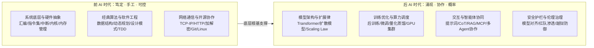
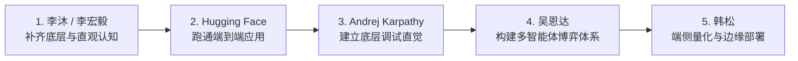
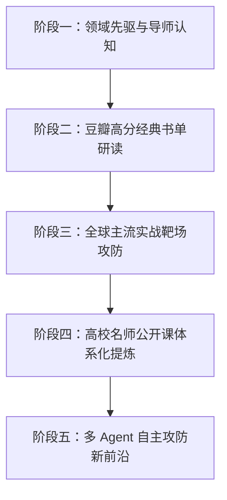

# 💻 计算机专业演化与网络安全学习成长路线

> 本指南系统整理计算机专业在 AI 浪潮前后的核心范式演化、精选分级经典书单、AI/Agent 开发者梯度进阶路径、网络安全全景成长路线以及蓝桥杯竞赛备考要点。

---

## 1. 计算机专业范式演化：前 AI 时代 vs 后 AI 时代

计算机学科的技术重心正在从“逐行手工编写代码以实现确定性逻辑”，向“算力与数据驱动智能模型涌现”迁移：

| 比较维度 | 前 AI 时代的计算机专业 | 后 AI 时代的计算机专业 |
| :--- | :--- | :--- |
| **底层核心** | 汇编语言、寄存器、流水线、系统调用、操作系统内核、指针与虚拟内存管理 | Transformer、自注意力机制、多模态架构、Scaling Law 与参数涌现能力 |
| **工程实现** | 经典数据结构（树/图）、排序算法、动态规划、面向对象设计模式、单元测试 | 预训练、指令微调（SFT）、RLHF/DPO、模型量化剪枝、MLOps/LLMOps |
| **交互范式** | 命令行终端、GUI 窗口、RESTful API 接口、Git 版本控制与开源协作 | 提示工程（Prompt）、思维链（CoT）、上下文学习、RAG 向量检索、MCP 协议 |
| **安全与认知** | 访问控制列表（ACL）、密码学认证、防火墙、二进制漏洞挖掘与内存保护 | 模型对齐（Alignment）、对抗攻击防御、安全护栏、AI 伦理审查与算力调度 |

---

## 2. 计算机核心经典分类书单

入局计算机专业建议优先选择通俗图解教材建立整体认知，随后紧扣工程实践精读经典大部头：

### 2.1 编程语言与基础入门
- **《C Primer Plus》**：C 语言入门首选，细致讲解语法细节与底层内存交互；
- **《Java 核心技术 卷Ⅰ》**：Java 基础、面向对象与集合框架必读经典；
- **《Python 编程：从入门到实践》**：语法精练且附带完整项目实践，零基础极佳选择；
- **《C# 7.0 核心技术指南》**：微软生态与 .NET 框架系统性开发圣经。

### 2.2 数据结构与算法（笔试与面试基石）
- **《算法图解》**：图文并茂，适合初学者在轻松语境下理解二分、贪心与图算法；
- **《大话数据结构》**：通俗拟人化语言，讲解线性表、树与哈希表；
- **《剑指 Offer》**：聚焦求职面试高频算法题型，归纳解题套路与边界边界测试；
- **《算法导论》**：经典权威巨著，理论推导详实，适合有数学基础的深度进阶。

### 2.3 操作系统与软硬件接口
- **《操作系统：三个简易的部分》（OSTEP）**：围绕“虚拟化、并发、持久化”三大核心概念展开，结构精炼且入门友好；
- **《深入理解计算机系统》（CSAPP）**：经典神作，打通汇编、链接、虚拟内存、网络编程全链路；
- **《现代操作系统》**：Tanenbaum 名著，深入剖析进程调度、死锁与文件系统实现。

### 2.4 计算机网络
- **《图解 HTTP》**：配图丰富，轻松掌握 Web 协议、状态码与安全机制；
- **《计算机网络（谢希仁）》**：高校教学与考研通识教材，体系严整规范；
- **《TCP/IP 详解 卷1：协议》**：逐字节分析数据报结构与滑动窗口协议，网络进阶必读书。

### 2.5 数据库技术
- **《MySQL 必知必会》**：极速掌握 SQL 增删改查语法与基础连接查询；
- **《高性能 MySQL》**：深度解析 InnoDB 存储引擎、B+ 树索引底层优化、锁机制与事务隔离级别；
- **《数据库系统概念》**：关系代数、范式理论与分布式事务的理论基石。

### 2.6 软件工程、架构与设计模式
- **《代码整洁之道 Clean Code》**：强调命名规范、函数单一职责与可读性法则；
- **《设计模式：可复用面向对象软件的基础》（GoF）**：23 种经典设计模式典范；
- **《重构：改善既有代码的设计》**：讲解在保证功能不变的前提下渐进式优化代码质量。

---

## 3. AI & Agent 开发者速通学习路线

针对 AI 与 Agent 领域新人的进阶路径，推荐遵循“梯度递进”的导师主线：

1. **第一梯队（夯实基础概念）**：
   - **李沐**（前亚马逊首席科学家）：从工程落地视角剖析 Transformer、Attention、Embedding 与 Token 边界，告别盲目调用；
   - **李宏毅**（台大教授）：讲解生动幽默，带领在 Google Colab 上动手构建小工具，快速建立动手信心。
2. **第二梯队（跑通行业标准应用）**：
   - **Hugging Face 官方教程**：涵盖开源模型部署、多 Agent 协作系统、Agentic RAG 等工业级实操范式。
3. **第三梯队（获取底层工程直觉）**：
   - **Andrej Karpathy**（前 OpenAI 联合创始人）：手写微型 GPT 与 AutoGPT 核心逻辑，通过 VS Code 逐行断点调试剖析循环调度与死锁问题。
4. **第四梯队（架构决策与宏观体系）**：
   - **吴恩达**（DeepLearning.AI）：通过结构化表格拆解 Agent 决策树，系统梳理多 Agent 协商与协作模式。
5. **第五梯队（极致轻量化与边缘计算）**：
   - **韩松**（MIT 教授）：聚焦 Efficient ML，掌握将大模型量化裁剪至 2GB 并部署至树莓派等端侧硬件的硬核技巧。

> ⚠️ **新手避坑指南**：
> - **切忌患上“框架仓鼠症”**：无需将 LangChain、LangGraph、LlamaIndex、Dify、Coze 逐一死记硬背，挑选一套趁手框架把完整项目跑通即可；
> - **尽早动手跑通 RAG**：准备几份 Markdown 或 PDF 笔记，亲自体会切分分块（Chunking）、向量库检索（Embedding Retrieve）与召回排序效果。

---

## 4. 网络安全全阶段学习路径与实操资源

### 4.1 阶段一：各领域代表专家
- **渗透测试**：关注余弦（知道创宇）；
- **Web 安全**：关注李沐阳；
- **逆向工程**：关注张银奎；
- **网络协议**：关注王树森；
- **漏洞挖掘**：关注张宴；
- **防火墙与防御**：关注刘忆智；
- **应急响应**：关注范渊（安恒信息）；
- **密码学**：关注王小云院士（清华大学）。

### 4.2 阶段二：高分权威书单
- 《网络攻击与防御》（豆瓣 9.2 分）
- 《Web 渗透测试实战》（豆瓣 9.1 分）
- 《密码学原理与实践》（豆瓣 9.0 分）
- 《应急响应技术实战》（豆瓣 9.0 分）
- 《Metasploit 渗透测试指南》（豆瓣 8.9 分）
- 《逆向工程核心原理》（豆瓣 8.8 分）
- 《网络安全攻防实战》（豆瓣 8.7 分）
- 《CTF 竞赛权威指南》（豆瓣 8.6 分）

### 4.3 阶段三：实战演练靶场与情报数据库
- **Hack The Box (HTB)**：全球知名的在线实战渗透与内网穿透靶场；
- **TryHackMe (THM)**：包含引导式教程与任务分解的安全学习平台，适合新手；
- **CTFtime**：全球 CTF 赛事日历、积分与战队排名聚合平台；
- **VulnHub**：提供离线虚拟机镜像（OVA），可在本地搭建独立靶机练习；
- **Exploit-DB**：公开发布的安全漏洞与验证代码（PoC/Exploit）归档库；
- **Root-Me**：涵盖多语言、逆向、密码学等多方向挑战关卡。

### 4.4 阶段四：名师公开课
- **操作系统安全**：哈尔滨工业大学 李治军；
- **计算机网络协议**：中国科学技术大学 郑烇；
- **密码学理论**：清华大学 王小云；
- **Web 安全规范**：OWASP 官方安全体系；
- **二进制与逆向工程**：吾爱破解公开课。

### 4.5 阶段五：多智能体自主渗透工具：PentAGI
- **项目定位**：开源全自动渗透测试智能体平台（GitHub 热门项目 [`vxcontrol/pentagi`](https://github.com/vxcontrol/pentagi)）；
- **技术亮点**：采用多 Agent 自主协同编排机制，支持从信息搜集、端口扫描、漏洞利用到权限维持全自动化运转，支持私有化本地部署。

---

## 5. 蓝桥杯软件赛（C/C++ 与 Python 组）备考指南

### 5.1 评测机制与代码规范铁律
1. **输入输出对齐**：评测机采用文本比对判定，输出格式必须与题目完全一致（包括大小写、空格与换行符），**严禁包含“请输入数据：”等交互提示文本**。
2. **函数返回值约定**：`main()` 函数退出时必须严格返回 `0`，返回非零值会被评测系统统一判定为运行时错误（Runtime Error）。
3. **显式头文件引用**：所有使用的函数必须在代码头部显式包含头文件（如 `<cstdio>`、`<algorithm>` 等），不得依赖本地开发环境特有的隐式包含配置。

### 5.2 官方备考资源与奖项规则
- **历届真题在线专区**：[蓝桥杯真题专区 (https://www.lanqiao.cn/courses/67522)](https://www.lanqiao.cn/courses/67522)
- **赛项系统备赛路径**：[赛项系统辅导路径 (https://www.lanqiao.cn/paths/3361/)](https://www.lanqiao.cn/paths/3361/)
- **奖项评定比例**：
  - *省赛*：设一、二、三等奖，总获奖比例原则上不超过 50%（省一等奖晋级全国总决赛）；
  - *全国总决赛*：设一、二、三等奖，总获奖比例原则上不超过 75%，均设最低及格基准线。

---

## 6. 开发者网络基础：HTTP 核心状态码速查

| 状态码 | 类别 | 官方语义 | 实际排查与处理建议 |
| :---: | :---: | :--- | :--- |
| **200 OK** | 2xx 成功 | 请求成功完成 | 数据正常返回，客户端按业务逻辑解析 Response Body。 |
| **201 Created** | 2xx 成功 | 资源已成功创建 | 常用于 POST 请求，代表数据库新记录已成功持久化。 |
| **301 Moved** | 3xx 重定向 | 资源永久重定向 | 目标 URI 已永久变更，搜索引擎与客户端应更新收录地址。 |
| **304 Not Modified** | 3xx 缓存 | 资源未修改 | 本地协商缓存有效（ETag / If-Modified-Since），直接读取缓存节省带宽。 |
| **401 Unauthorized** | 4xx 客户端 | 身份未认证 | 请求缺少认证凭证（Bearer Token / Session Cookie），需跳转登录页。 |
| **403 Forbidden** | 4xx 客户端 | 禁止访问 | 已识别用户身份，但该用户无权访问指定接口或资源（权限不足）。 |
| **404 Not Found** | 4xx 客户端 | 资源不存在 | 请求路径或参数有误，或者对应资源已被软删除。 |
| **429 Too Many Req** | 4xx 客户端 | 请求过于频繁 | 触发速率限制（Rate Limit），需遵循 Retry-After 标头指数退避重试。 |
| **500 Server Error** | 5xx 服务端 | 服务端内部崩溃 | 服务端出现未捕获异常或空指针崩溃，需调取服务端日志排查。 |
| **503 Unavailable** | 5xx 服务端 | 服务暂时不可用 | 服务器过载或处于停机维护期，结合心跳检测待其自愈恢复。 |
