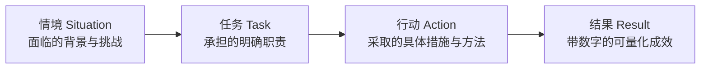
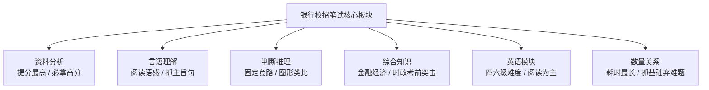

# 💼 求职网申、笔试备考与商业副业灵感库

> 本指南汇总了银行校招网申简历修改、STAR 法则量化表达、笔试通关策略，以及商业副业灵感库（Starter Story）与软硬件成长博主清单。

---

## 1. 银行校招网申、简历优化与量化表达

银行校招网申通常采用“机检关键词初筛 + 人工复审”的双重筛选机制。简历必须结构清晰、信息量密集且具备高度量化特征。

### 1.1 基础信息与排版优化

- **个人信息精简**：
  - 将“出生年月日”直接提炼为当前明确年龄（如：22岁），降低审阅心智负担；
  - 政治面貌若非党员或预备党员可不单列；
  - 求职意向需严格匹配具体岗位（如“管培生”、“通用业务岗/综合柜员”、“金融科技岗”），投递不同银行或岗位时单独导出对应版本；
  - 学习成绩排名优异（如专业前 10% 或前 20%）建议直接在教育背景中清晰标注。
- **技能与证书整合**：
  - 建议将模块统一命名为“技能与证书”；
  - 第一行罗列熟练操作的专业软件（如 Excel 高级函数/VBA、Python、SQL、Wind 等）；
  - 第二行规范陈列已取得的专业资质（如银行从业资格、证券从业、初级会计、计算机二级等）。
- **英语四六级应对策略**：
  - **严禁虚构**：网申系统若强制要求证书编号或分数，严禁捏造虚假信息，资格复审环节会直接淘汰并记入不良信用记录；
  - **自主填写文本框**：若未通过四级或分数在 425 分以下（如 410 分），可如实填写具体分数或写明“具备熟练的中文公文处理能力、良好的英语业务资料阅读意愿与持续学习规划”，观感显著优于留空或直接写“无”。

---

### 1.2 经历撰写：STAR 法则与数字量化

#### 1. 兼职与实习经历（无对口银行实习时的补救）
即便只有餐饮、零售店、客服、助教或地推等经历，也切勿留空，银行重点看重抗压、细致度与沟通服务意识：
- **综合柜员方向示例**：
  > 负责门市日常收银与客户接待。在高峰时段日均接待顾客 **80+ 人次**，耐心解答业务咨询并平抚顾客排队焦虑；严格执行每日两轮对账盘点，达成连续 **90 天账实核对零差错**，获评当季度优秀兼职员工。
- **客户经理方向示例**：
  > 协助开展线下产品推广与会员拓展。主动挖掘潜在客户诉求，通过结构化话术累计对接意向客户 **200 余人**，达成有效转化率 **18%**（超出团队平均水平 5 个百分点），展现出良好的商务沟通与抗压承载力。

#### 2. 校园与学生干部经历
- **班委 / 社团组织**：
  - 避免泛写“负责班级事务”，应具体表述为：“作为班级组织委员，统筹建立班级 50 名同学的学籍与信息管理台账；策划并执行 3 场主题团日活动，参与覆盖率达 100%”。
- **青年志愿者活动（重要加分项）**：
  - 银行属于金融服务业，高度重视同理心与服务奉献精神；
  - 重点突出在大型赛会、社区服务中的“人流引导、身份核对、物资盘点与突发情况协调”。

#### 3. 获奖经历填写公式
$$	ext{规范表述} = 	ext{奖项完整官方名称} + 	ext{获评时间} + 	ext{评选比例/含金量} + 	ext{个人核心贡献}$$
- *示例*：“2024 年国家励志奖学金（全院选拔比例前 3%）；2023 年省大学生金融创新大赛二等奖（负责商业计划书撰写与财务模型搭建，团队核心答辩人）”。

---

## 2. 银行校招笔试（EPI / 综合知识）通关攻略

银行笔试试题题量大、时间紧，核心解题策略是**保住高性价比模块、熟练常规套路、战略性舍弃超长计算**。

1. **资料分析（性价比最高模块）**：
   - *策略*：必须拿到 85% 以上的分数。熟记基期量、现期量、增长率、比重、平均数公式；熟练运用首数法、特征分数法与截位舍入技巧，杜绝逐项精算。
2. **言语理解**：
   - *策略*：难度居中。练习快速抓取段落主旨句、转折关联词与设问关键词，每日保持 20 道题的阅读题感。
3. **判断推理**：
   - *策略*：图形推理、定义判断、类比推理考点高度规律化。建立错题本，归纳对称性、曲直性、笔画数等高频特征。
4. **数量关系（战略取舍）**：
   - *策略*：平均做题时间极长。优先完成工程问题、行程问题、利润折扣等基础方程题，对复杂的排列组合或几何难题直接代入或排除猜答，切勿超时影响整体节奏。
5. **综合知识（经济、金融、会计、时政）**：
   - *策略*：考察面广但不深，无需通读厚教材。考前两周重点背诵高频金融常识（货币政策、利率传导、银行业务分类）及近半年的重大国内外时政热点。
6. **英语模块**：
   - *策略*：难度约在大学英语四级至六级之间，以单选题与短篇阅读为主，保持每日刷题速度，稳住基础分。

---

## 3. 商业与创业副业灵感库：Starter Story

- **官方网站**：[starterstory.com](https://www.starterstory.com)
- **数据库定位**：全球知名的独立创业与副业案例研究平台，深度收录 **3,000+** 真实创业者、独立开发者（Indie Hackers）与微型 SaaS 团队的商业项目。
- **核心沉淀内容**：
  - 详细披露项目初期的启动资金、获客渠道（SEO / 冷邮件 / 社交媒体推广）；
  - 真实的月经常性收入（MRR）与年收入（ARR）财务数据；
  - 创业初期走过的弯路、验证需求的方法以及具体技术选型。
- **对开发者的实践启发**：
  - 寻找小而美（Micro-SaaS）的细分切入点，避开与大型巨头正面竞争；
  - 借助大模型与自动化工作流（如 API 集成、自动化内容生成）将个人精力集中于高价值环节。

---

## 4. 精选自媒体与软硬件学习博主清单

### 4.1 综合视野与职场成长博主精选
- **AI 视频与时代趋势**：**GenJi**（普通人在 AI 工具时代的实操与变现探索）；
- **市场盯盘与趋势研判**：**求道作手哥**（通俗易懂的盯盘视角与盘面结构）；
- **口播与表达呈现**：**薛辉小清新**（短视频口播逻辑与结构化语言表达）；
- **宏观财经资讯**：**趋势孙哥**（复杂经济政策与宏观趋势的通俗解读）；
- **视频制作与剪辑**：**影视飓风剪辑课**（从视觉构图、光影到专业调色剪辑全流程）；
- **职场认知与年轻人解题**：**姜 Dora 在此**（职场心理、向上沟通与职业路径规划）。

### 4.2 软硬件与嵌入式技术博主精选（Bilibili 优质生态）
- **STM32 单片机**：**江协科技**（公认的入门宝藏教程，实验演示清晰，源码注释详尽）；
- **FreeRTOS 实时操作系统**：**韦东山**（深入内核任务调度、队列机制与驱动架构）；
- **电子元器件与电路原理**：**爱上半导体**（通俗动画讲解二极管、三极管、MOS 管与运放底层物理机制）；
- **C 语言与编程基础**：**黑马程序员**（体系扎实，适合零基础入门系统自测）；
- **硬件项目实操与制板**：**嘉立创EDA**（打通原理图设计、PCB Layout 到打样焊接完整实物交付）；
- **PCB 画板与电路设计**：**Expert电子实验室**（高频高速电路布线与 EMC 抗干扰技巧）；
- **单片机与外设基础**：**正点原子官方**（硬件驱动、寄存器配置与官方参考手册解读）；
- **Linux 操作系统底层**：**韩顺平**（从常用命令、网络配置到 Shell 编程的系统性大课）。
