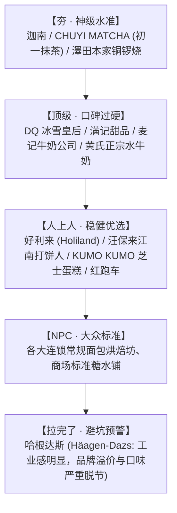

# 🍱 生活指南与实用速查手册

> 本指南汇总了杭州下沙高校园区外卖餐饮优选清单、杭州甜品天梯榜、人际交往送礼红黑榜，以及职场幽默文案与学术讲座速查。

---

## 1. 杭州下沙高频外卖餐饮选餐与配送参考

结合配送距离、起送门槛与菜品特色整理的下沙高校区外卖实测数据：

| 商家名称 | 推荐菜品 / 招牌特色 | 月销量 | 起送与配送费 | 配送时间与距离 | 最适场景 |
| :--- | :--- | :---: | :---: | :---: | :--- |
| **就他佳·虎皮肘子拌饭 (下沙银泰店)** | 虎皮肘子饭 + 招牌剁椒酱 | 1000+ | 起送 ¥15 / **免配送费** | 约 15 分钟 / 465m | **极速一人食**（距离极近，出餐配送最快） |
| **面总管-温州人面馆 (金沙湖店)** | 经典温州汤面、大火炒面炒饭 | 5000+ | 起送 ¥20 / **免配送费** | 约 24 分钟 / 1.8km | **热乎汤面小吃**（实惠大碗，性价比高） |
| **外婆家·外婆送到家 (杭州下沙店)** | 糖醋里脊 + 农家小炒肉 + 酸汤肥牛 | 7000+ | 起送 ¥25 / **免配送费** | 约 27 分钟 / 2.9km | **多人拼单正餐**（月销第一，菜品稳定丰富） |
| **银记肠粉店 (金沙店)** | 鸡蛋瘦肉肠粉、广式干炒牛河 | 2000+ | 起送 ¥25 / **免配送费** | 约 28 分钟 / 2.1km | **粤式风味简餐**（清淡爽滑） |
| **蔡记蒸饺·杀猪菜馆 (吾角天街店)** | 东北酸菜猪肉蒸饺、芹菜鲜肉蒸饺 | 4000+ | 起送 ¥20 / **免配送费** | 约 30 分钟 / 2.6km | **北方水饺面点**（手工现包，皮薄馅足） |
| **临榆炸鸡腿 (金沙店)** | 酥脆炸大鸡腿、香骨鸡 + 甘梅粉 | 3000+ | 起送 ¥20 / **免配送费** | 约 31 分钟 / 1.9km | **下午茶解馋炸物**（肉质鲜嫩多汁） |
| **黄荣记杭州软蛋饼 (下沙店)** | 杭州传统软蛋饼 + 油条 + 榨菜里脊 | 3000+ | 起送 ¥15 / **免配送费** | 约 31 分钟 / 2.6km | **地道杭州风味早餐/宵夜** |
| **车记烤鸭卷饼瘦肉丸 (学林街店)** | 脆皮烤鸭卷饼 + 温州瘦肉丸 | 2000+ | 适中 / **免配送费** | 约 31 分钟 / 2.5km | **特色街头小吃搭档** |
| **澳门陈光记烧味饭店 (下沙中心店)** | 广式烧腊烤鸭叉烧三拼饭 | 4000+ | 起送 ¥20 / 配送约 ¥0.1 | 约 31 分钟 / 2.7km | **港式烧腊快餐**（支持超时赔付） |
| **宝岛便当 (四季广场店)** | 超大块香脆爆汁脆皮鸡排饭 | 3000+ | 起送 ¥15 / 配送约 ¥0.6 | 约 31 分钟 / 4.0km | **平价便当**（分量足，配菜多样） |
| **春家非遗手工小吃 (下沙龙湖欢肆)**| 兰溪手工鸡子粿 + 鲜肉小馄饨 | 3000+ | 起送 ¥20 / 配送约 ¥0.6 | 约 34 分钟 / 2.6km | **非遗江南面点**（汤头清鲜，小吃地道） |
| **新发现 (下沙龙湖店)** | 招牌酱油炒饭 + 秘制蛋黄鸡翅 | 6000+ | 起送 ¥25 / **免配送费** | 约 37 分钟 / 2.2km | **宿舍/聚餐丰盛拼单** |
| **绿茶餐厅 (杭州下沙龙湖店)** | 香脆松板肉、绿茶招牌烤鸡 | 5000+ | 起送 ¥20 / **免配送费** | 约 38 分钟 / 2.0km | **杭帮菜招牌聚餐**（门槛略低于外婆家） |
| **太犇牛手作茶铺 (杭州下沙宝龙店)**| 微甜款烤布蕾黑糖珍珠鲜奶茶 | 1000+ | 按平台设定 | 约 66 分钟 / 6.9km | **下午茶饮品**（配送较远，需预留时间） |

---

## 2. 杭州甜品梯队天梯榜

按风味层次、原料用料、出品稳定性与真实口碑划分的甜品天梯：

---

## 3. 人际交往与送女生礼物赞诀（红黑榜）

送礼的核心在于**日常留意对方未被满足的需求或情绪价值**，严禁照搬低质批发平台热搜爆款。

### 3.1 推荐送出的实用高品位清单
- **鲜花绿植**：精巧包装的季节花束（郁金香、重瓣百合、洋桔梗），营造仪式感；
- **Jellycat 毛绒玩偶**：正版手感软糯、造型趣味治愈，具备极高情绪陪伴价值；
- **经典大牌口红**：提前确认对方日常常用色系（如豆沙色、水红色、红茶色，避免盲猜偏门色号）；
- **带光圈高清化妆镜**（如 imkoco 等品牌）：多色温可调光，贴合日常梳妆高频场景；
- **富士拍立得相机**：立等可取的实体胶片质感，聚会记录极佳；
- **高支棉/真丝亲肤睡衣**：注重面料触感与居家舒适度；
- **高颜值纯钛轻量保温杯**（如可可小颜等）：健康环保无异味，方便随身携带；
- **小众沙龙香薰 / 融蜡灯**：温润散香，提升宿舍或卧室生活质感；
- **经典小巧手链**：设计简约、银质或小珍珠点缀，便于日常穿搭通勤；
- **声波电动牙刷**：外观精致、刷毛柔软细腻，呵护口腔健康的实用礼物。

### 3.2 坚决避雷的踩雷清单
- ❌ **毒离子散盒（旋转花朵多色眼影盒）**：廉价飞粉，配色恶俗，极易造成皮肤过敏；
- ❌ **发光水晶奖杯 / 定制大奖状**：自我感动型无用摆件，占地且无法融入正常审美；
- ❌ **低成本廉价 DIY 相册 / 水晶翻转照片**：缺乏设计美感，极易落灰；
- ❌ **死亡芭比粉系口红 / 荧光粉彩妆**：极难驾驭，几乎注定闲置；
- ❌ **劣质膨化食品零食大礼包**：缺乏心意，廉价感明显；
- ❌ **两米高超大廉价毛绒熊**：面料粗糙易掉毛，宿舍与卧室极难存放且难以清洗。

---

## 4. 职场办公软件谐音梗调侃（幽默速记）

现代打工人借由 Office 办公三件套发出的自嘲调侃：

- **PowerPoint**：做 PowerPoint 的人，在公司既没有 **Power**（权力），也提不出有价值的 **Point**（观点）；
- **Word**：整天写 Word 文档的人，在决策会议上几乎没有任何 **Word**（话语权）；
- **Excel**：整天调公式理数据的人，自身的职场表现并不 **excel**（卓越出众）；
- **Microsoft Office**：深度使用 Microsoft Office 办公套件的人，在 **Office**（办公室）里处境往往既 **micro**（微不足道）又 **soft**（软弱妥协）。

---

## 5. 学术报告讲座案例参考

- **主题**：人工智能发展与地方债务治理：“赋能效应”还是“挤出陷阱”？——基于城投债发行利差的实证研究；
- **报告主讲人**：肖作平 教授（杭州电子科技大学会计学/金融学博导）；
- **核心方法论**：以地方政府融资平台（城投债）发行利差作为被解释变量，运用实证计量经济学双重差分模型（DID）量化分析人工智能产业政策赋能对地方债务融资成本与风险溢价的影响机制。
