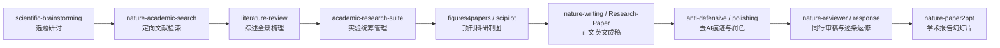

# 🛠️ AI Agent 实用 Skills 全景清单与功能详解

> 本文档将资料库中涉及的所有 AI Agent 技能（Skills）按照应用领域进行系统化归纳，详细说明每个 Skill 的核心功能、适用场景及触发指令。

---

## 一、 通用研发、架构与工作流 Skills（TOP 10）

此类 Skill 主要运行于 Coding Agent（如 Claude Code、Codex、Cursor、DSH 等）中，用于规范软件研发全生命周期：

| Skill 名称 | 领域分类 | 核心功能是干嘛的 | 典型适用场景 |
| :--- | :---: | :--- | :--- |
| **`find-skills`** | 技能检索 | **自主检索并推荐最适配的技能包**。当面对不熟悉的业务或缺乏工具支持时，AI 会在生态索引库（如 skills.sh）中搜索符合任务特征的 Skill 并提示安装。 | 刚进入陌生工程，不确定需要安装哪些工具能力时。 |
| **`grill-me`** | 需求推演 | **像严格的产品负责人一样对开发者进行多轮连环追问**。针对模糊的想法持续挖掘目标、使用边界、性能约束、异常处理与验收标准，倒逼形成清晰的需求规范。 | 只有一个模糊创意或初步设想，缺少落地细则与边界考虑时。 |
| **`grill-with-docs`** | 文档审计 | **贴合现有设计文档、PRD 或 API 规范进行针对性审查**。比对实现代码与设计文档之间的出入，核对术语一致性，挑出逻辑漏洞与未覆盖的边界场景。 | 已经写好了初步技术方案或代码，需审查是否符合既定技术协议时。 |
| **`improve-codebase-architecture`** | 架构重构 | **对工程整体架构进行全面体检与诊断**。自动分析模块间的依赖关系、循环引用、层级穿透与过度耦合，输出系统化的重构建议与分层解耦路径。 | 代码库越改越庞大臃肿、修改一处引发多处连锁崩溃时。 |
| **`tdd`** | 测试驱动 | **强制执行测试驱动开发（TDD）规范**。要求 Agent 严禁直接修改业务代码，必须“先编写必定失败的红灯测试用例 $\rightarrow$ 编写最小可用代码转为绿灯 $\rightarrow$ 局部重构优化”。 | 修改核心业务逻辑、修复高危缺陷或新增关键模块以防代码回归时。 |
| **`agent-browser`** | 网页代办 | **赋予 Agent 操作真实浏览器的能力**。支持自主启动浏览器、打开网页、模拟点击、输入表单、处理弹窗、滚动截图并抓取动态渲染后的 DOM 数据。 | 需要 Agent 登录后台、填写在线系统、采集动态数据或进行端到端测试时。 |
| **`frontend-design`** | 前端设计 | **生成高审美、去 AI 模板味的前端界面**。跳出千篇一律的通用组件库机械感，优化色彩空间、阴影层级、版式留白、字体排印与精致微交互细节。 | 解决由 AI 自动生成的前端页面呆板廉价、缺乏品牌设计质感的问题。 |
| **`setup-matt-pocock-skills`** | 流程脚手架 | **一键安装并配置 Matt Pocock 的成套工程开发工作流**。包含规范的 TypeScript 研发规范、代码审查标准、Git Worktrees 工作流与分支收敛规则。 | 组建新团队或开辟新项目，需快速统一工程规范与 Agent 协作纪律时。 |
| **`handoff`** | 状态交接 | **跨模型或跨会话无缝交接当前任务上下文**。自动提取已完成项、当前卡点、核心技术决策、待办清单及运行状态，生成标准化交接摘要。 | 对话上下文过长需要压缩、从开发模型切换至推理模型，或隔天继续推进时。 |
| **`triage`** | 工单排期 | **海量缺陷与 GitHub Issue 自动化分类评级**。自动提取用户反馈中的复现步骤，区分 Bug 等级与优先级，并建议负责人员与处置路径。 | 仓库积累了大量待处理 Issue，无法迅速甄别紧急程度与处理方案时。 |

---

## 二、 学术科研全流程与论文写作 Skills

此类 Skill 覆盖从文献调研、实验设计、数据制图到论文撰写与返修答辩的学术全流程：

### 2.1 综合型科研全流程 Agent 框架
- **`academic-research-skills (ARS)`**（49.9k ★）：覆盖从文献检索、研究框架搭建、正文撰写到同行审稿意见回复的一站式学术管家。
- **`K-Dense-AI/scientific-agent-skills`**（47.2k ★）：直连 PubChem、ChEMBL 等百余种权威科学数据库，集成 177 个专业计算分析技能，面向生化材料与生物医学。
- **`Auto-claude-code-research-in-sleep (ARIS)`**（16.8k ★）：支持无人值守的自动化科研 Agent，自主完成假设提出、交叉评审循环与实验代码迭代。
- **`Orchestra-Research/AI-Research-SKILLs`**（13.1k ★）：专为 AI / ML 算法研究打造，贯通数据清洗、模型训练、微调调优、效果评测与论文提纲。
- **`Supervisor-Skills`**（7.7k ★）：香港科技大学博导经验提炼的“AI 科研副导师”，提供从 Idea 构思、可行性评估到投稿路线规划的结构化辅导。

### 2.2 科研专项与细分阶段 Skills
- **文献与选题阶段**：
  - `scientific-brainstorming`：基于前沿热点与课题组积累，启发具有可操作性的创新选题；
  - `nature-academic-search`：跨多数据库定向精准抓取高被引文献与核心论点；
  - `literature-review`：自动化归纳文献脉络，提炼现有方法局限与争议焦点；
  - `hamuleite`：大型学术文献、开源教材与金融行业研报聚合检索入口。
- **实验统筹与数据统计**：
  - `academic-research-suite`：统筹多组实验进度、实验参数与基线模型比对；
  - `statistical-analysis`：提供方差分析、假设检验、显著性 p 值计算与置信区间统计；
  - `Auto-Empirical Research-Skills`：专为社科实证研究设计，内置 2 万余个计量经济学与实证分析微技能。
- **科研绘图与可视化**：
  - `figures4papers`：精选顶会顶刊高水平 Python 绘图代码库（热图、森林图、ROC 曲线等）；
  - `scipilot-figure-skill`：输入数据自动生成符合期刊规范的高清图表，内置合规与配色校验；
  - `Paper Craft Skills`：一键生成论文机制原理图（Workflow）与方法架构图；
  - `academic-figure-skill`：生信专属，适配单细胞转录组、聚类降维图等组学专业图表；
  - `academic figure generator`：上传正文自动提取论证逻辑，反推配图设计并输出绘图指令。
- **论文撰写、润色与去 AI 痕迹**：
  - `nature-skills`：专为 Nature / Science 级别的学术英语修辞、图解摘要与期刊规范适配；
  - `Research Paper Writing Skills`：彭斯达教授团队适配 ML / CV 领域的英文学术论文规范成稿包；
  - `anti defensive writing skill`：**专门剔除 AI 写作常见的多余免责声明、模糊修辞与冗余铺垫**，使学术观点表达更自信客观；
  - `PaperSpine`：梳理实验结论与论据因果链条，强化论文主线逻辑，抵御审稿人挑刺；
  - `Deep Research Skill`：8 阶段严密核查引注信源真实性，杜绝模型幻觉编造虚假文献。
- **审稿返修与学术答辩**：
  - `nature-reviewer`：模拟挑剔严苛的顶刊审稿人对初稿展开全面预审评议；
  - `nature-response`：针对审稿人意见自动生成客气、严谨且有理有据的逐条回复信（Response Letter）；
  - `nature-paper2ppt`：提炼论文核心结论与架构图，直接转为结构清晰的学术汇报 PPT。

---

## 三、 视频创作、剪辑与视觉设计 Skills

此类 Skill 赋能 Agent 介入多媒体制作，实现从脚本策划到成片导出的全流程自动化：

| Skill 名称 | 核心定位是干嘛的 | 适用制作场景 |
| :--- | :--- | :--- |
| **`MoneyPrinterTurbo`** | **自动化短视频生产线**。输入主题或文案，全自动完成文案润色、素材爬取、TTS 配音与字幕对齐压制。 | 批量生产知识科普、解说类短视频或自媒体内容。 |
| **`OpenCut`** | **网页端多轨视频剪辑**。剪映（CapCut）的开源替代版，支持时间轴多轨道混流与转场。 | 在浏览器端轻量化剪辑、快速拼接与合成视频。 |
| **`Remotion`** | **用 React 代码写视频**。通过组件化声明式代码编排时间轴、图表与动画，高保真渲染为 MP4。 | 制作动态数据排行榜、代码演示片、产品功能更新展示。 |
| **`OpenMontage`** | **全流程数字制片工作室**。打通剧本分镜、音画素材调度与后期渲染，实现工业级流水线。 | 复杂多场景视频制片与长视频自动化装配。 |
| **`HyperFrames`** | **HTML/CSS 动画转视频渲染器**。将前端网页关键帧动效无损稳定导出为高清视频。 | 官网主页动效、营销海报动画导出为社媒展示视频。 |
| **`Pixelle-Video`** | **主题一键成片工具**。仅需给出关键词，即可自动策划画面并混剪背景音乐。 | 灵感初剪与快速样片产出。 |
| **`video-use`** | **口播视频粗剪助手**。智能检测实拍素材中的静音区、停顿气口与口误废话，生成紧凑样片。 | 真人出镜口播、访谈录像的一键净化与粗剪。 |
| **`video-shotcraft`** | **电影级分镜设计器**。依据经典视听语言规划镜头景别、机位运动与节奏变换。 | 拍摄前期策划、广告脚本与三维动画分镜规划。 |
| **`seedance2-skill`** | **视频生成模型提示词生成器**。针对视频大模型特点针对性优化运镜控制与物理动力学提示词。 | 驱动即梦、Sora、Runway 等生成连续稳定的镜头画面。 |
| **`Taste-Skill`** | **资深设计师视角审美质检**。模拟设计专家审视视觉物料，挑出版面杂乱、排印冲突与视觉噪点。 | UI 界面、海报物料发布前的视觉审美把关。 |
| **`Impact-Cable`** | **23 组快捷出图美化指令**。集成排版、高级调色、渐变光效与微动效点缀。 | 免去复杂反复的 Prompt 试错，迅速拉升出图成色。 |

---

## 四、 游戏开发、逆向工程与系统扩展 Skills

| Skill 名称 | 领域分类 | 核心功能是干嘛的 |
| :--- | :---: | :--- |
| **`higgsfield-game-generation`** | 游戏启动 | 专用于游戏原型初始框架的快速构建与生成。 |
| **`game-engine`** | 底层框架 | 提供游戏物理碰撞检测、重力加速度、场景对象树等基础架构支撑。 |
| **`develop-web-game`** | 网页游戏 | OpenAI 官方维护，专用于基于 Canvas / WebGL 开发轻量级网页互动小游戏。 |
| **`multiplayer-game`** | 多人联机 | 集成 Rivet，负责多人在线房间匹配、心跳保活与状态帧同步。 |
| **`game-feel`** | 手感调优 | 负责打击感与微反馈微调，包括打击停顿（Hitstop）、屏幕震动、粒子特效与动态音效。 |
| **`game-ui-design` / `game-ui-ux`** | 游戏界面 | 规范设计游戏 HUD 抬头显示、生命值状态条、道具背包与菜单布局交互。 |
| **`threejs-game-ui-designer`** | 3D 界面 | Three.js 专属 UI 界面方案，适配 Web 3D 游戏摄像机视角与控件悬浮。 |
| **`game-design-theory`** | 数值理论 | 玩法核心循环（Core Loop）、关卡心流结构、概率掉落与成就奖励数值机制设计。 |
| **`SwiftUI-Agent-Skill`** | 苹果生态 | 为 Agent 注入原生苹果生态界面开发经验，全面覆盖布局、动画与状态流管理。 |
| **`image-blaster`** | 3D 场景 | 输入单张静态图片，约 5 分钟内生成带有物理碰撞网格与环境音效的可探索 3D 场景。 |
| **`breach-yangh`** | 提示词脱壳 | 专用于对特定 Agent 工具进行系统提示词提取与脱壳分析。 |
