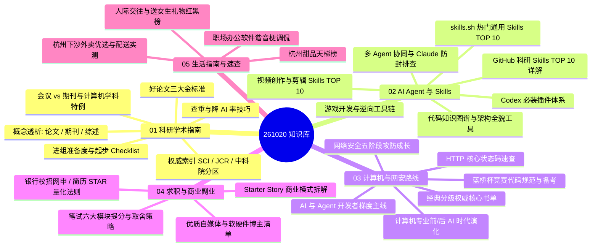

# 🧭 261020 综合知识笔记与前沿技术全景库

> 本知识库对 261020 原有 OCR 碎片资料进行了系统化重构、去重沉淀与网络权威资料扩充。内容按照逻辑领域清晰拆分为 5 个独立专题模块，涵盖从学术科研、AI Agent 生态、计算机与网安成长路线，到校招求职及生活指南的完整知识体系。

---

## 🗂️ 知识库全景导航与专题模块

### 专题文档直达链接

1. [01-科研与学术全流程指南.md](<261020/01-科研与学术全流程指南.md>)
   - **核心内容**：论文与期刊的区别、会议论文对本科生的三大优势、CCF-A 顶会认可度、SCI 影响因子与 JCR/中科院分区机制、好论文三大金标准、大雅/知网查重与降 AI 检出率策略、进组启动清单。
2. [02-AI-Agent与Skills生态体系.md](<261020/02-AI-Agent与Skills生态体系.md>)
   - **核心内容**：skills.sh 全球 TOP 10 核心开发 Skills、Codex 14 大必装插件、GitHub 科研 Skills TOP 10 深度剖析（ARS、ARIS、Nature Skills、Figures4Papers 等）、GitDiagram / GitIngest / Graphify 架构图谱工具、视频与游戏开发 Skills、Orca + Droid 多 Agent 协同架构与 Claude 网络防封配置（DNS Type 64/65 阻断机制）。
3. [03-计算机与网络安全成长路线.md](<261020/03-计算机与网络安全成长路线.md>)
   - **核心内容**：前 AI 时代（底层/算法/系统）与后 AI 时代（Transformer/Scaling Law/Agent/安全治理）范式演进、经典专业分类必读书单、李沐/李宏毅/Karpathy/吴恩达/韩松 5 梯度进阶路线、网络安全专家与实战靶场、蓝桥杯代码规范铁律与 HTTP 状态码速查。
4. [04-求职备考与商业副业灵感.md](<261020/04-求职备考与商业副业灵感.md>)
   - **核心内容**：银行网申简历优化、英语四级缺失应对技巧、STAR 法则柜员与客户经理量化案例、笔试资料分析/言语/数量/综合知识提分策略、Starter Story 商业模式拆解、B 站软硬件学习博主（江协科技/韦东山/黑马等）。
5. [05-生活指南与实用速查.md](<261020/05-生活指南与实用速查.md>)
   - **核心内容**：杭州下沙高校园区外卖餐饮实测选餐参考（按拼单热炒、一人食、地方风味分类）、杭州甜品天梯榜、人际交往送女生礼物实用红黑榜、职场 Office 软件谐音梗调侃、学术讲座实证案例。

---

## ⚡ 高频核心工具与开源项目速查

| 工具 / 项目名称 | 官方站点 / GitHub 仓库 | 核心功能定位 | 快捷使用方式 |
| :--- | :--- | :--- | :--- |
| **GitIngest** | [gitingest.com](https://gitingest.com)   [`coderamp-labs/gitingest`](https://github.com/coderamp-labs/gitingest) | 将任意 GitHub 代码仓库快速转为大模型友好的精简纯文本 | 将仓库 URL 中的 `github.com` 替换为 `gitingest.com` |
| **GitDiagram** | [gitdiagram.com](https://gitdiagram.com)   [`ahmedkhaleel2004/gitdiagram`](https://github.com/ahmedkhaleel2004/gitdiagram) | 自动将代码仓库渲染为模块架构图与依赖调用拓扑图 | 将仓库 URL 中的 `github.com` 替换为 `gitdiagram.com` |
| **Graphify** | [`Graphify-Labs/graphify`](https://github.com/Graphify-Labs/graphify) | 本地 AST 静态分析，将代码、SQL、文档构建为无矢量库知识图谱 | 终端执行 `$ /graphify .`，生成交互式 `graph.html` |
| **Diagram Design** | [`cathrynlavery/diagram-design`](https://github.com/cathrynlavery/diagram-design) | 44 种高质量出版级技术架构图模版，输出自包含 HTML/SVG | 导入 Coding Agent 规范生成架构图 |
| **Academic Research Skills** | [`Imbad0202/academic-research-skills`](https://github.com/Imbad0202/academic-research-skills) | 文献调研、初稿起草、审稿回复与论文定稿全流程助手 | Claude Code / Codex 直接加载使用 |
| **Scientific Agent Skills** | [`K-Dense-AI/scientific-agent-skills`](https://github.com/K-Dense-AI/scientific-agent-skills) | 集成 177+ 科学计算技能与 100+ 专业数据库的科研工具箱 | 面向生物、化学、医学与材料科研计算 |
| **Eleven** | [`Zfinix/eleven`](https://github.com/Zfinix/eleven) | Agent 优先的二进制应用程序跨平台逆向工程套件 | 支持分析 ELF、PE、DEX/APK 与 GGUF 模型权重 |
| **PentAGI** | [`vxcontrol/pentagi`](https://github.com/vxcontrol/pentagi) | 基于多智能体协同机制的开源全自动网络渗透平台 | 支持本地私有化部署，自主执行渗透攻防 |
| **MoneyPrinterTurbo** | [`harry0703/MoneyPrinterTurbo`](https://github.com/harry0703/MoneyPrinterTurbo) | 自动化短视频生产线：文案、素材、配音、字幕一键合成 | 本地部署批量产出高清短视频 |
| **Starter Story** | [starterstory.com](https://www.starterstory.com) | 收录 3,000+ 真实独立开发者、创业项目与副业商业案例库 | 拆解细分领域需求、MRR 盈利模型与冷启动渠道 |

---

## 📌 核心知识快速要览

### 1. 学术科研发表关键准则
- **载体选择**：本科生冲刺保研加分优先考虑高质量会议论文（审稿周期 1~2 个月、议题明确、篇幅友好）；计算机学科看重 CCF-A 顶会，基础理工科看重中科院一区顶刊。
- **好论文核心**：不仅在于华丽的图表与排版，更在于在同行认可的共识框架中，精准提炼一个具备明确增益与解释力的科学问题，并附带完备的消融实验闭环。

### 2. AI Agent 落地工作流法则
- **拒绝框架仓鼠症**：无需死磕所有框架，优先跑通一套最小可行的 RAG 知识库问答或接口调用工具链。
- **多模型配比**：主控调度选用顶级大模型（如 Opus 5.5 / Fable 5.1）把关架构决策与巡检，常规繁杂任务分发给轻量廉价模型，兼顾质量与成本。

### 3. 求职简历 STAR 法则公式
$$	ext{经历描述} = 	ext{业务场景 (S)} + 	ext{承担任务 (T)} + 	ext{具体行动 (A)} + 	ext{量化数字结果 (R)}$$
- 突出抗压、细致度与客户沟通意识，杜绝空泛的主观定性描述，用真实数据（如接待人次、对账差错率、转化率）支撑个人竞争力。
