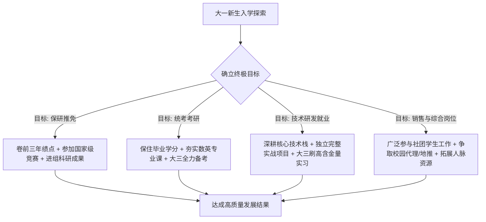

# 01-大学大一核心课程速通网课推荐与四年规划指南

## 视频基本信息

| 属性 | 详情 |
| :--- | :--- |
| **视频标题** | 大学大一核心课程速通网课推荐与四年规划指南 |
| **视频文件名** | `01-大学大一核心课程速通网课推荐与四年规划指南.mp4` |
| **视频时长** | 3 分 09 秒 (189.8 秒) |
| **主题领域** | 大学学业规划 / 工科大一基础课速通 / 职业路径反推 |
| **适用人群** | 大学新生、大一工科/电气/计算机/信通类学生、迷茫期大学生 |

---

## 核心主旨

大学课程节奏与高中完全不同，面对大一密集的基础课，必须通过优质网络资源弥补课堂教学的不足。同时，大学四年需以终为始，尽早明确保研、考研、就业或创业的核心目标，反推各阶段的时间与精力分配。

---

## 核心课程速通网课推荐清单

### 1. 高等数学（同济版）与微积分
- **宋浩老师（《高等数学》全程教学视频 2.0 版）**：
  - **特色**：全网播放超亿次，板书细致，善于穿插生动实例缓解枯燥感，覆盖大一高数全部考点。
  - **不足与互补**：课程未覆盖《复变函数与积分变换》，建议补充学习 B 站「翔翔的学习频道」3 小时纯板书串讲。
- **一高数**：
  - **定位**：期末 3 小时速通通关视频，提炼高频公式与考点，适合考前突击与题型梳理。

### 2. 线性代数
- **一高数（《线性代数！从零开始到精通》）**：
  - 适合配合校内教学做系统化题型训练。
- **3Blue1Brown（《线性代数的本质》双语精讲合集）**：
  - 计算机与工科必看，通过空间几何变换直观理解矩阵乘法、行列式、特征值与特征向量的本质内涵。

### 3. 英语四六级备考
- **博主「我是瑞斯拜」**：
  - 重点学习长篇阅读匹配题满分解题技巧与押题班套路。
- **考试策略建议**：
  - 具备工科高考基础的学生，四级只需考前熟悉题型与做题逻辑即可过线；
  - 升学保研与名企求职主要考察六级成绩，应将重心放在刷高六级分数上；
  - 绝大部分非涉外岗位无需报名口语考试。

### 4. 大学物理
- **张云翼（《大学物理期末速成：核心+拓展+习题》）**：
  - 覆盖力热光电核心考点，适合期末考前梳理知识框架与刷核心例题。

### 5. 单片机与嵌入式入门
- **keysking（《超易懂的 STM32 急速入门教程》）**：
  - 采用高质量 3D 动画与实战操作结合，快速建立硬件开发兴趣与认知。
- **江协科技（《STM32 入门教程》）**：
  - 嵌入式领域经典实战教材，包含细致的代码分析、外设配置与底层原理，适合参赛打项目做深入拓展。

### 6. 计算机基础与工程制图
- **C 语言**：浙江大学翁恺老师经典课程，体系严谨，注重编程逻辑构建，配合 Visual Studio 进行实操调试。
- **工程制图**：基础制图规范看专业速成合集，期末最后一节答疑课必须参加，掌握划定考核重点。

### 7. 电路原理（电气类专业核心）
- **石群老师（《电路》80 集全）**：
  - 讲解通俗透彻，建议以 2 倍速观看，紧密配合校内布置的习题集练习。
- **备考进阶**：水木珞研电气考研课程（邱关源教材体系）、南京邮电大学 813 电路教材解析。

---

## 大学四年以终为始发展路径

1. **确立长远方向**：明确未来职业倾向，分析自身擅长与厌恶的工作形态，避免盲目跟风。
2. **多方请教经验**：主动与本专业优秀的学长学姐交流，获取选课、竞赛、进组与实习的一手信息，沉淀出个人方法论。
