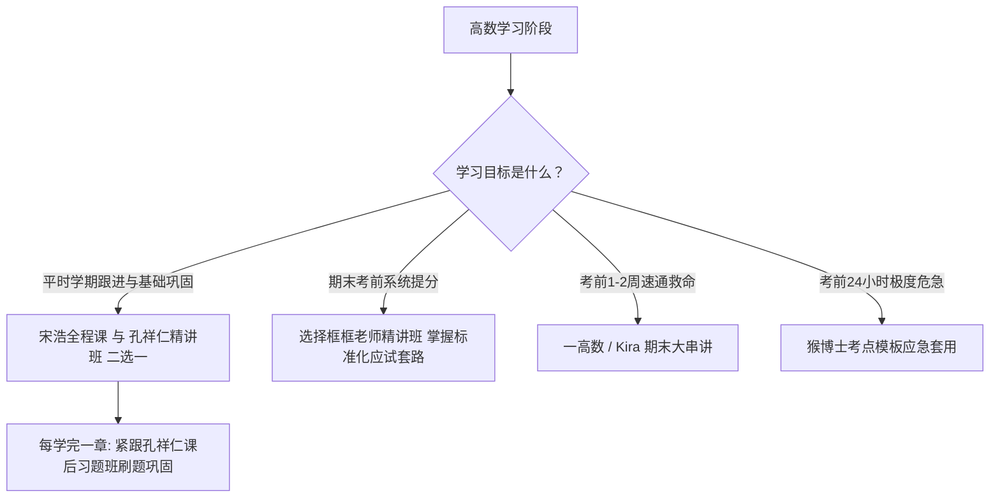

# 02-大学高等数学全网名师网课测评与期末救命备考指南

## 视频基本信息

| 属性 | 详情 |
| :--- | :--- |
| **视频标题** | 大学高等数学全网名师网课测评与期末救命备考指南 |
| **视频文件名** | `02-大学高等数学全网名师网课测评与期末救命备考指南.mp4` |
| **视频时长** | 2 分 26 秒 (146.5 秒) |
| **主题领域** | 大学高数学习法 / 网课名师横向测评 / 期末备考决策 |
| **适用人群** | 大学高数课堂听不懂的学生、期末高数挂科边缘突击者 |

---

## 核心主旨

大学高数上课听不懂属于普遍现象，无需焦虑。关键在于根据自身的数学基础和当前阶段（开学系统学习 vs 期末救命通关），在全网主流高数名师中选择最匹配的课程体系，建立“精讲理解 + 步骤刷题 + 考前串讲”的三步闭环。

---

## 全网六大高数名师横向测评

| 讲师 / 课程 | 教学特色与优势 | 局限性与不足 | 最优适用场景 |
| :--- | :--- | :--- | :--- |
| **宋浩老师** | 纯黑板板书授课，教学幽默生动，善于穿插段子与学习心态调节，基础推导详尽。 | 总课程时长达 100+ 小时，战线极长；缺少部分工科后续课程（如复变）。 | 适合开学初期从零起步、课后打牢基础的同学。 |
| **孔祥仁老师** | 题型与解题步骤条理清晰，配套同济七版/八版《课后习题全解》（140+ 小时超精讲）。 | 题量巨大，多元微积分部分讲解较深入。 | 适合每学完一章用来针对性刷题巩固、追求高分的同学。 |
| **一高数 / Kira** | 期末考点提炼极其干练，3~9 小时大串讲，浓缩高频公式与必考经典题型。 | 基础定理推导较简略，不适合零基础系统精学。 | 适合期末临考前 1~2 周快速突击、梳理考点脉络。 |
| **李天意老师** | 注重数学概念本质与微积分核心思想，从高中数学平滑衔接至大学高等数学。 | 偏向理论启发与思想认知，题型应试覆盖率中等。 | 适合高中基础薄弱或对数学底层逻辑有求知欲的同学。 |
| **框框老师** | 精讲班深谙大学期末考试套路，题目梯度由易到难，解题套路清晰规范。 | 风格相对严肃标准化。 | 适合期末追求稳妥过线或冲刺优秀成绩的同学。 |
| **猴博士** | 纯题型公式套用模板教学，时长极短，2~4 小时解决一个模块。 | 题目稍微变换条件或增加综合度极易卡壳，无法形成真实数学能力。 | 适合平时完全没学、考前最后 1~2 天绝望求及格的极端情况。 |

---

## 高数学习路径决策树

---

## 实操建议

1. **平时不松懈**：刚开学阶段务必扎实打牢极限、导数与不定积分的基本计算能力；
2. **刷题重步骤**：高数大题严格按照步骤计分，参考孔祥仁老师的解题板书规范，避免跳步失分；
3. **分段复习**：多元微分与多重积分计算量大，期末前至少留出 10 天集中突破计算题型。
