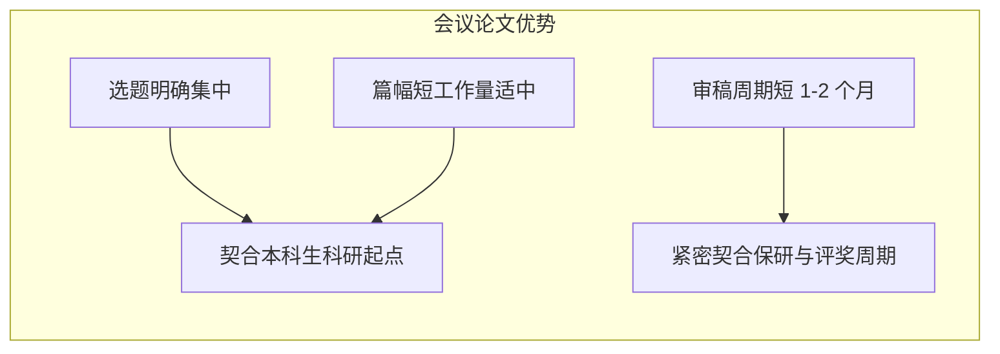

# 05-本科生科研入门全攻略：论文概念、会议期刊与SCI发表指南

## 视频基本信息

| 属性 | 详情 |
| :--- | :--- |
| **视频标题** | 本科生科研入门全攻略：论文概念、会议期刊与SCI发表指南 |
| **视频文件名** | `05-本科生科研入门全攻略：论文概念、会议期刊与SCI发表指南.mp4` |
| **视频时长** | 10 分 00 秒 (600.3 秒) |
| **主题领域** | 本科生学术启蒙 / 论文期刊辨析 / 索引分区与发表规范 |
| **适用人群** | 准备进组做科研的本科生、保研推免冲刺者、学术论文初学者 |

---

## 核心主旨

学术科研并非遥不可及的高门槛领域。本科生入门科研，关键在于建立清晰的学术概念地图：透彻理解论文与期刊、研究论文与综述论文的区别，掌握学术会议相对于期刊对本科生的独特优势，认清 SCI、CCF 及各大核心索引的分区与评价机制，并围绕规范性、闭环性与边际创新三大金标准开展研究。

---

## 核心概念全景透析

### 1. 论文与期刊的本质辨析
- **论文（Paper）**：围绕一个明确的科学或工程问题，严谨交代研究背景、实验方法与实际结果的学术文章。
  - **核心结构**：问题（为什么做） $\rightarrow$ 方法（怎么做） $\rightarrow$ 结果（得到了什么）。
- **期刊（Journal）**：由学术出版社或专业学会创办，雇佣专业编辑与同行评议专家组织、审核并定期刊登高质量学术论文的连续出版物。
- **生动隐喻**：
  - **研究论文（Research Article）** 犹如一份“新菜谱”：围绕“做出一道新菜”详细交代食材用量与烹饪步骤；
  - **综述论文（Review Article）** 犹如一份“带有点评的菜单”：系统梳理领域内已有菜系做法，总结学术共识与争议焦点，指出未来值得探索的空间。
- **导师为何建议新手先写综述**：
  - 倒逼大量文献阅读与输入；
  - 快速建立该研究领域的全景知识图谱；
  - 精准找到尚未被前人充分解决的细分切入点。

---

## 会议论文对本科生的三大优势

1. **选题难度低、方向明确**：学术会议通常设有年度主题和聚焦议题，研究范围高度明确，不易跑偏；
2. **篇幅限制友好、单篇工作量适中**：相较于动辄数十页且要求极完备论证的顶级期刊长文，会议论文更适合新手起步；
3. **审稿周期短、录用时效快**：通常有固定的截稿、集中评审与返稿时间表（通常 1~2 个月出结果），能够完美赶上大三下学期保研推免与评奖评优的关键时间节点。

---

## 权威学术索引与评价机制

### 1. 主流学术索引分类
- **自然科学**：SCI / SCIE（科学引文索引）；
- **工程与计算机**：CCF 推荐目录（中国计算机学会针对顶级会议与期刊设立的 A/B/C 类评级标准）；
- **社会科学与人文**：SSCI（社会科学）、A&HCI（艺术与人文）、CSSCI / 南核（中文社会科学引文索引）；
- **中文综合核心**：北大核心、CSCD（中国科学引文数据库）。

### 2. 影响因子与分区逻辑
- **期刊影响因子（JIF）计算公式**：
  $$\text{JIF}_Y = \frac{Y \text{ 年对该刊前两年发表论文的总引用次数}}{\text{该刊前两年发表的可引用论文总数}}$$
- **学科属性差异**：考古、历史等学科知识沉淀周期长，医学、材料、AI 等热门领域引用爆发快，因此**跨学科直接对比影响因子数值毫无意义**。
- **分区标准**：
  - **JCR 分区**：按学科排名前 25% 为 Q1，25%~50% 为 Q2，依此类推；
  - **中科院分区**：采用头部期刊比例更严苛的评价体系（1区通常仅占前 5%~10%）。

---

## 好论文的三大金标准

| 标准维度 | 核心衡量要求 | 执行落地建议 |
| :--- | :--- | :--- |
| **1. 呈现规范美观** | 视觉表达清晰、排版格式严谨、数据可视化规范。 | 机制路线图一目了然，图表配色与字体严格遵循期刊模板，参考文献无格式残缺。 |
| **2. 研究闭环可靠** | 实验结果与论据严丝合缝回应开篇提出的核心科学问题。 | 杜绝为了用模型而拼凑无意义数据，每一组消融实验都直接支撑一个具体的推理结论。 |
| **3. 具备研究贡献** | 在前人已有的知识基石上产生哪怕微小的边际推进。 | 不必颠覆现有体系或发明通用算法，在已有问题上补充新证据、新数据集或优化边际效率即可。 |

---

## 本科生进组启蒙建议

1. **转变心态**：无需等学完全部专业课才进组，科研是在解决具体问题的过程中查漏补缺；
2. **AI4S 时代的科研重心**：大语言模型已经能辅助完成代码编写与初稿润色，**提出一个有价值的好问题、设计严密的论证逻辑**才是核心竞争力。
