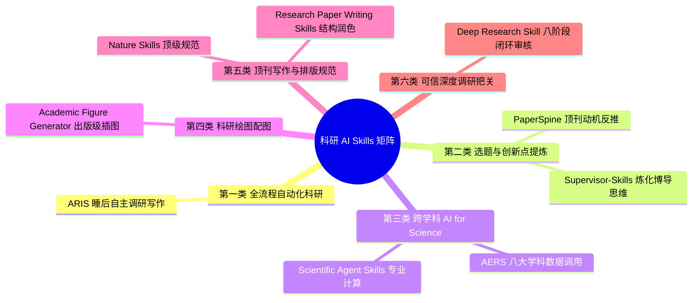

# 06-学术科研必装AI-Agent与Skills六大体系深度盘点

## 视频基本信息

| 属性 | 详情 |
| :--- | :--- |
| **视频标题** | 学术科研必装AI-Agent与Skills六大体系深度盘点 |
| **视频文件名** | `06-学术科研必装AI-Agent与Skills六大体系深度盘点.mp4` |
| **视频时长** | 1 分 46 秒 (106.4 秒) |
| **主题领域** | 科研 AI 工具链 / Claude Code 科研 Skills / AI for Science 插件生态 |
| **适用人群** | 研究生、做科研课题的本科生、学术论文撰写者 |

---

## 核心主旨

GitHub 上涌现出海量科研向 Agent 插件与 Skills，盲目全装只会导致提示词冗余与上下文污染。本指南系统筛选并梳理出真正经过学术检验的六大类高价值科研 Skills 矩阵，贯穿文献调研、创新点提炼、科学计算、学术绘图、规范写作到深度复核的全流程。

---

## 科研 Skills 六大分类矩阵

---

## 六大核心体系详解

### 1. 全流程自动科研 Agent —— ARIS (Auto-claude-code-research-in-sleep)
- **核心定位**：全自动无人值守科研流水线。
- **功能特性**：在后台自主执行海量文献检索、关联文献清洗、核心数据提取与初稿撰写，实现“一觉醒来直接查阅初稿与调研提纲”。

### 2. 选题与创新点 Skill —— Supervisor-Skills & PaperSpine
- **Supervisor-Skills**：将资深博导十余年带教与课题把关经验封装为 AI 提示词与指导插件，针对性指出初拟选题的硬伤与不足。
- **PaperSpine**：专注于顶刊优秀论文的“骨架逆向拆解”，引导研究者从已有顶会文章中反推核心研究动机（Motivation），寻找微创新切入点。

### 3. 跨学科 AI for Science —— AERS (Auto-Empirical Research Skills)
- **覆盖领域**：生物、化学、医学、材料、环境等 8 大自然科学方向。
- **底层互联**：直接连通 PubChem、ChEMBL 等专业学术数据库与科学计算工具链，自主执行分子式检索、反应动力学推导与实证分析。

### 4. 科研绘图 Skill —— Academic Figure Generator
- **核心定位**：学术配图与系统架构图自动生成器。
- **功能特性**：输入论文核心论点与实验流程，自动提取关键实体、逻辑关系与数据走势，输出符合期刊出版色彩与分辨率规范的矢量图和高清插图。

### 5. 顶刊写作与排版 Skill —— Nature Skills & Research Paper Writing Skills
- **Nature Skills**：严格对齐 Nature 及其子刊的学术文风规范、主被动语态比例、段落展开模式与图注排版细节。
- **Research Paper Writing Skills**：针对计算机视觉与机器学习方向，优化 Introduction、Related Work 与 Ablation Study 的专业表达。

### 6. 可信科研深度调研 —— Deep Research Skill for Claude Code
- **核心定位**：按 Anthropic 官方最佳工程实践打造的质量优先科研把关助手。
- **工作流机制**：包含八个严谨阶段（问题拆解、源头求证、反例推导、交叉校验等），杜绝大模型学术幻觉，论文投稿前审查首选。

---

## 落地安装与使用准则

1. **按需配置**：各阶段只激活当前所需的 1~2 个 Skill，避免一次性注入全部技能造成上下文窗口爆炸；
2. **保持学术诚信**：AI 生成内容必须经过真实实验数据校验，严禁伪造或虚构实验结果。
