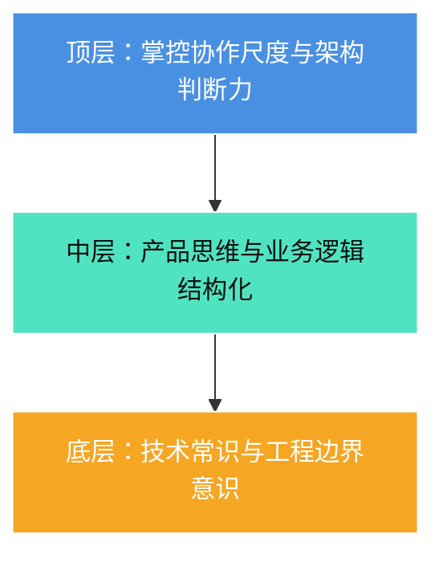

# 08-Vibe-Coding实战：从提示词到架构判断力的AI全栈进阶

## 视频基本信息

| 属性 | 详情 |
| :--- | :--- |
| **视频标题** | Vibe-Coding实战：从提示词到架构判断力的AI全栈进阶 |
| **视频文件名** | `08-Vibe-Coding实战：从提示词到架构判断力的AI全栈进阶.mp4` |
| **视频时长** | 12 分 01 秒 (721.0 秒) |
| **主题领域** | Vibe Coding 全景认知 / AI 编程范式转型 / 开发者核心壁垒 |
| **适用人群** | 采用 AI 辅助编程的开发者、全栈工程师、希望依靠 AI 独立交付产品的个人 |

---

## 核心主旨

AI 时代死记硬背编程语法的传统学习路径已失去核心价值。谷歌新增代码超 75% 由 AI 生成，编程已从“人写代码”全面转型为“AI创作 + 人类把关”。纯靠 Vibe Coding 做出可靠项目的核心，在于建立“架构判断力、精确沟通能力与底层边界意识”。

---

## 产业变革趋势与权威实测认知

### 1. 科技巨头的工程现实
- 谷歌 CEO 皮查伊在 Google Cloud Next 大会上披露：谷歌内部所有新增系统代码库中，**超过 75% 的代码由 AI 自动生成**。
- 人类工程师的核心职责全面转向系统架构设计、边界把控与最终安全审核。

### 2. METR 权威实验揭示的效率偏差
- **实验设计**：16 名资深开发者面对 246 个随机决定的开发任务，量化评估使用 AI 的真实效率。
- **认知陷阱**：
  - 很多开发者误以为用了 AI 就能立竿见影提速；
  - 实际中，如果不具备底层判断力，大量时间会被消耗在**审查劣质产出、反复调试提示词、等待空档期**上，甚至比自己纯手写更慢。
- **破局关键**：大模型基座能力的代际跃迁（如 2026 最新评估）与**开发者驾驭 AI 方法论的成熟**相结合，才能带来真正的几何级生产力爆发。

---

## Vibe Coding 核心能力金字塔

### 1. 准确描述能力（UI 与业务的专业化表达）
- **杜绝模糊词汇**：对 AI 说“把界面做得好看一点”，AI 只能靠随机概率猜测；
- **采用行业标准术语**：
  - 明确“留白（Spacing）、层级（Hierarchy）、主色调（Primary Color）”；
  - 给出精准约束：“深蓝、扁平、无投影，标题与正文字号拉开两档层级”。

### 2. 边界意识与底层认知
- **AI 的本质是概率生成**：它擅长根据已有模式续写，但容易在冷门、复杂业务组合中产生幻觉；
- **工具调用与执行**：模型坐镇中枢，读文件、网络检索、执行命令行是由外挂工具完成的；
- **理清四个真相**：
  1. 能执行 $\neq$ 真正理解；
  2. 代码跑通 $\neq$ 架构正确；
  3. 拥有记忆 $\neq$ 永不遗忘（存在上下文遗忘与窗口截断）；
  4. 负责生成 $\neq$ 保证保真。

### 3. 把项目“讲清楚”的产品逻辑能力
- **第一层：业务运行逻辑（Logic）**：明确数据从哪里进、经过什么功能流转、落到哪个数据库；
- **第二层：痛点与目标转化**：不仅是做一个功能，而是拆解用户在各个节点的心智与反馈闭环；
- **第三层：点子转化为 AI 可执行步骤（Action Items）**。

---

## 实操箴言

写代码这一苦活累活已被 AI 大幅抹平。开发者应将 80% 的精力投放在：
1. **说得准**：以高信息密度的专业术语下发指令；
2. **看得懂**：凭借扎实的技术常识一眼洞察 AI 产出中的逻辑硬伤；
3. **管得住**：守住系统的数据安全与架构底线。
