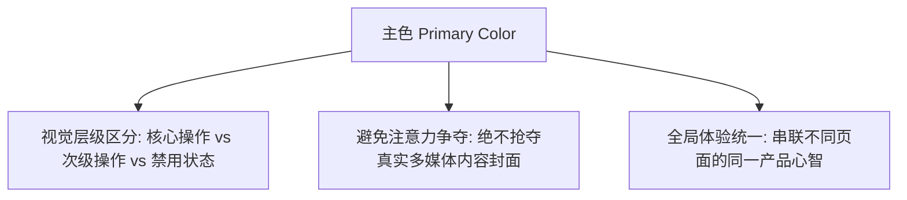

# 09-Vibe-Coding术语课：前端UI主色规范与AI提示词指南

## 视频基本信息

| 属性 | 详情 |
| :--- | :--- |
| **视频标题** | Vibe-Coding术语课：前端UI主色规范与AI提示词指南 |
| **视频文件名** | `09-Vibe-Coding术语课：前端UI主色规范与AI提示词指南.mp4` |
| **视频时长** | 5 分 02 秒 (302.0 秒) |
| **主题领域** | 前端 UI 设计规范 / Vibe Coding 提示词优化 / 视觉主色与操作层级 |
| **适用人群** | 使用 AI 编写前端页面的独立开发者、全栈工程师、UI/UX 初学者 |

---

## 核心主旨

许多开发者在使用 AI 生成前端界面时，常常面临“界面杂乱难看、却不知如何向 AI 准确表达修改需求”的困境。其核心症结在于缺乏色彩层级概念。主色（Primary Color）是全站视觉重点与操作层级的中枢，必须坚持“选色给条件、用色给结论、全站统一定死”的工程规范。

---

## 主色（Primary Color）的核心概念认知

### 1. 什么是主色，什么不是主色
- **主色的本质**：界面中的共同视觉重点，英文为 **Primary Color**。它负责引导用户的视觉焦点，明确第一步该点击哪里。
- **常见误区**：
  - 主色不是全站面积最大的颜色；
  - 更不是所有卡片、背景、标题和每一个按钮都随意套用的颜色；
  - 大面积滥用主色会导致界面视觉过载，丧失层级重点。

### 2. 品牌色与界面色的分离原则
- **物理现实物料**：品牌标志、宣传画册、包装箱的品牌色往往追求高饱和度与视觉冲击力；
- **界面实际需求**：软件 UI 必须为屏幕阅读、高对比度与长时间操作服务。不能生硬将品牌物料色直接作为主要界面色，必须经过衍生与适配。

---

## 主色在界面中的三大核心作用

1. **确立操作层级（Action Hierarchy）**：
   - 主要操作（Primary Action，如“立即提交”、“去结算”）：使用饱和度适中的主色实心按钮；
   - 次要操作（Secondary Action，如“保存草稿”、“取消”）：使用浅色底或线框按钮；
   - 禁用操作（Disabled）：置灰处理，禁止使用主色。
2. **避免与核心内容抢夺注意力**：
   - 音乐播放器已有色彩绚丽的专辑封面、电商应用已有商品高清实物图；
   - 界面主色必须保持克制，充当容器底色与引导辅助，杜绝反客为主。
3. **保持全站页面认知的一致性**：
   - 播放页、歌曲列表页、个人设置页必须拥有共同的主色调约束，避免页面割裂。

---

## 向 AI 下达色彩指令的标准沟通公式

### 核心法则：“选色给条件，用色给结论”

| 沟通维度 | 传统模糊表达（反面教材） | 专业精准指令（推荐表达） |
| :--- | :--- | :--- |
| **项目类型** | “给我做一个科技感的主色。” | “这是一个企业订单管理后台，注重高效率和长时间阅读，主色请选用低饱和、高对比度的深稳藏蓝（如 #1E40AF）。” |
| **受众与场景** | “适合年轻人用，弄花哨一点。” | “用户常在户外强光或移动场景下使用，请确保主色按钮与背景色在 WCAG AA 级对比度（至少 4.5:1）以上。” |
| **全站一致性** | “这个页面用绿色，下一个用橙色。” | “全站统一定死这一主色作为 Primary Color，不要随意换色，并放回真实订单表格与表单中验证可读性。” |

---

## 落地实操 Checklist

- [ ] 全站是否唯一确定了一个十六进制主色值（Hex Code）？
- [ ] 关键行动按钮（CTA）是否具备最强的视觉引导力？
- [ ] 文字标题是否保持低调中性深色，避免直接套用高亮主色导致阅读疲劳？
- [ ] 将主色应用后的实际页面置于暗光与户外强光模式下，检查字迹与按钮是否清晰可辨。
