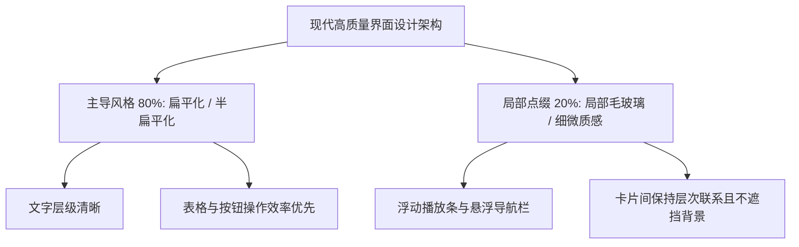

# 10-Vibe-Coding术语课：四大前端设计风格与混合搭配实战

## 视频基本信息

| 属性 | 详情 |
| :--- | :--- |
| **视频标题** | Vibe-Coding术语课：四大前端设计风格与混合搭配实战 |
| **视频文件名** | `10-Vibe-Coding术语课：四大前端设计风格与混合搭配实战.mp4` |
| **视频时长** | 6 分 24 秒 (384.6 秒) |
| **主题领域** | 前端视觉风格系统 / Vibe Coding 提示词实战 / 现代 UI 设计模式 |
| **适用人群** | 全栈开发者、前端工程师、独立产品创作者 |

---

## 核心主旨

面对 AI 编写的前端界面，很多开发者常常觉得“不好看却不知道怎么改”。核心在于未能掌握前端主流设计风格（Visual Style）的分类特征与搭配法则。掌握扁平化、拟物化、新拟物与毛玻璃四大风格，并坚持“主导风格 + 局部点缀”的架构设计，能让 AI 生成的代码质感实现质的跃升。

---

## 四大主流视觉风格特征剖析

| 设计风格 | 英文术语 | 核心视觉特征 | 适用业务场景 |
| :--- | :--- | :--- | :--- |
| **扁平化** | **Flat Design** | 去除所有真实物体的纹理、反光和厚度，依靠纯色块、明确字号层级、间距与分割线布局；衍生版 **Semi-flat** 增加微弱阴影区分浮层。 | 业务后台、数据看板、订单管理、工具类高效办公软件。 |
| **拟物化** | **Skeuomorphism** | 模拟物理世界真实物体的材质、纹理、按压触感与金属反光，唤起用户的物理使用直觉。 | 黑胶唱片播放器、复古相机应用、专业音频调音台。 |
| **新拟物** | **Neumorphism** | 按钮与背景色浑然一体（通常为同一浅灰底色），依靠微调的一组高光内阴影与深色外阴影营造凹陷或隆起的软弹质感。 | 智能家居控制面板、物联网开关仪表、极简控制台。 |
| **毛玻璃** | **Glassmorphism** | 采用半透明背景、多层级高斯模糊（Backdrop Blur）、微弱浅白描边与浮动阴影，营造通透且富有纵深的物理悬浮感。 | 现代多媒体播放浮层、iOS 风格弹窗、仪表盘状态指示卡。 |

---

## 风格混合实战策略：主导风格 + 局部点缀

### 1. 为什么不能全局盲目滥用单一特殊风格
- 如果将一个订单后台的每个表格单元格、每一个输入框都做成毛玻璃或新拟物：
  - 界面会失去清晰的边界；
  - 用户的视觉焦点完全涣散；
  - 大量模糊计算还会带来前端渲染性能下降与卡顿。

### 2. 正确的混合设计范式
- **业务后台（如订单与库存系统）**：
  - 100% 坚持扁平化与半扁平化，用高对比度的文字层级与规范的线框区分状态与操作；
- **展示型与音乐型产品（如独立音乐展示主页）**：
  - 页面主体保持简洁扁平排版以突出歌手与专辑信息；
  - 仅在底部的**悬浮播放条或弹出控制面板**上叠加一层半透明毛玻璃材质，既与背景封面建立视觉关联，又凸显层次。

---

## 向 AI 精准描述设计风格的指令范式

### 反面模糊指令：
> “把这个音乐播放器页面做高级一点，做得有质感。”

### 正面结构化专业指令：
> “请按照以下规范重构音乐播放器：
> 1. **主导风格**：整体采用清晰的半扁平（Semi-flat）设计，背景采用纯净深色（#121212），列表项依靠微弱阴影和 12px 留白拉开呼吸感；
> 2. **局部毛玻璃**：底部正在播放悬浮栏采用 Glassmorphism 规范，背景使用 rgba(255, 255, 255, 0.08)，配合 20px 背景高斯模糊与 1px 微白透明边框，透出底层专辑封面的微弱光晕；
> 3. **操作清晰度**：核心播放/暂停按钮使用实心主色高亮，普通切歌按钮保持半透明中性灰，确保层级分明。”
