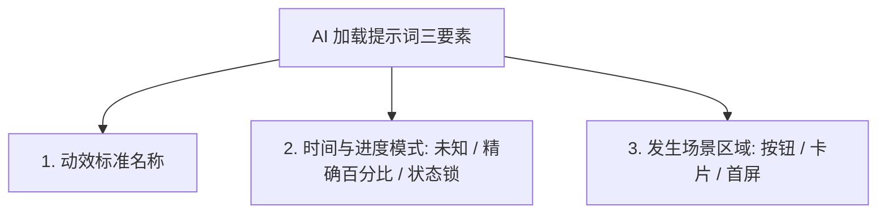

# 11-AI前端开发：7种加载动效模式与标准Prompt生成指令

## 视频基本信息

| 属性 | 详情 |
| :--- | :--- |
| **视频标题** | AI前端开发：7种加载动效模式与标准Prompt生成指令 |
| **视频文件名** | `11-AI前端开发：7种加载动效模式与标准Prompt生成指令.mp4` |
| **视频时长** | 1 分 07 秒 (67.4 秒) |
| **主题领域** | 前端加载动效模式（Loading Patterns） / UI 动效设计 / AI 提示词库 |
| **适用人群** | 前端开发、Vibe Coding 实践者、交互设计师 |

---

## 核心主旨

在前端交互设计中，杜绝向 AI 提出笼统的“做个加载动画”。加载动效绝非仅有一种形态，不同的加载时长、空间尺度与操作状态对应着截然不同的交互模式。精确区分并掌握 7 种主流加载动效及其向 AI 描述的标准指令，是交付工业级高质量前端的关键细节。

---

## 7 大加载动效模式全景对比

| 编号 | 动效模式 | 英文名称 | 核心状态特征 | 适用典型场景 |
| :--- | :--- | :--- | :--- | :--- |
| **01** | **旋转菊花** | **Spinner** | 处理时间未知、不显示具体百分比数值。 | 异步数据拉取、系统后台计算中、局部小区域等待。 |
| **02** | **线性进度条** | **Progress Bar** | 任务进度可精确量化、水平空间充裕。 | 文件上传、资源下载、安装包解压、步骤流引导。 |
| **03** | **环形进度条** | **Circular Progress** | 空间紧凑、需要清晰展示 0%~100% 闭环。 | 仪表盘指标卡、存储空间占用优化、紧凑状态指示。 |
| **04** | **骨架屏** | **Skeleton** | 先行占位保留排版结构，避免数据返回时页面跳动。 | 资讯信息流首屏、个人主页资料卡、商品列表渲染。 |
| **05** | **骨架微光** | **Shimmer** | 叠加在骨架屏上的平滑移动亮带，强调活跃度。 | 骨架屏的高级增强，提示用户系统正在持续响应。 |
| **06** | **按钮加载** | **Button Loading** | 点击后禁用按钮，文字变状态词并带微旋转图标。 | 表单提交、订单支付、文档生成，防重复点击。 |
| **07** | **整页遮罩** | **Page Loader** | 全屏覆盖，等待核心资源与环境全部初始化完毕。 | 网页首次冷启动、复杂单页应用初始化加载。 |

---

## 7 大动效标准 AI Prompt 提示词库

### 01. Spinner（旋转菊花）
> **Prompt 指令**：“做一个一直平滑转圈的极简加载指示器，不显示百分比数字。只向用户明确表达系统仍在后台处理，时长未知。”

### 02. Progress Bar（进度条）
> **Prompt 指令**：“做一条从左往右线性平滑增长的进度条，数字百分比与填充条同步从 0% 变化至实际进度，达到真实终点后立即停住，不要无限循环动画。”

### 03. Circular Progress（环形进度）
> **Prompt 指令**：“在指标卡内实现一个紧凑的圆形进度环，环形轨迹从 0% 平滑走向目标值，中心数字百分比同步更新，完成后固定显示。”

### 04. Skeleton（骨架屏）
> **Prompt 指令**：“在数据返回前，使用浅灰色占位块先行占住头像、标题与正文段落位置；真实内容返回后无缝替换，页面严禁产生剧烈的布局位移（CLS）。”

### 05. Shimmer（微光扫带）
> **Prompt 指令**：“在骨架屏的灰色占位块上，叠加一条半透明柔和亮光从左往右匀速扫过；占位块本体保持静止，不产生缩放或抖动。”

### 06. Button Loading（按钮加载）
> **Prompt 指令**：“用户点击‘提交’按钮后，立刻将按钮设置为 disabled 状态防止重复点击；按钮文案切换为‘正在生成...’并内置微型 Spinner；操作成功后切换为对勾图标与‘已完成’。”

### 07. Page Loader（全页遮罩）
> **Prompt 指令**：“在页面初次打开冷启动时，使用全屏背景画面覆盖整页；当所有核心字体与首屏接口数据就绪后，执行平滑淡出动画，让完整界面自然显现。”
