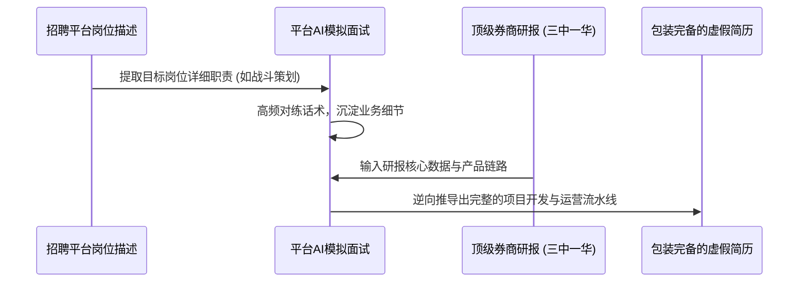

# 12-揭秘实习简历造假套路与AI逆向业务逻辑拆解

## 视频基本信息

| 属性 | 详情 |
| :--- | :--- |
| **视频标题** | 揭秘实习简历造假套路与AI逆向业务逻辑拆解 |
| **视频文件名** | `12-揭秘实习简历造假套路与AI逆向业务逻辑拆解.mp4` |
| **视频时长** | 30 秒 (30.7 秒) |
| **主题领域** | 实习求职内幕 / 简历造假套路揭秘 / AI 逆向业务推导 |
| **适用人群** | 在校大学生、求职应届生、技术与业务面试官 |

---

## 核心主旨

揭露当前大学生与职场新人实习求职中普遍存在的“简历造假新套路”。从过去的夸大其词升级为如今的“无中生有”，剖析其利用招聘平台 AI 模拟功能和顶级券商研报进行业务逆向的完整流水线；同时引导求职者借鉴其结构化学习业务逻辑的思路，但在现实求职中严守职业道德底线。

---

## 实习简历“大造假时代”流水线四步拆解

### 1. 锚定标杆岗位描述（JD）
- 造假者不再泛泛而写，而是直接锁定 BOSS 直聘等平台头部企业的核心岗位（如游戏事业部“战斗策划”）；
- 逐字拆解岗位任职要求（底层机制、技能数值策划、打击感设计、动效还原等专业术语）。

### 2. 利用平台自带 AI 模拟面试反向套取话术
- 借助招聘软件内置的“AI 模拟面试”功能，反复扮演候选人与 AI 面试官对答；
- 记录面试过程中 AI 追问的深水区问题，将回答逻辑整理为标准话术脚本。

### 3. 下载“三中一华”顶级券商行业研报
- 从中金、中信证券、中信建投、华泰证券等顶级券商研报中，下载详尽的行业深度分析报告与上市产品拆解分析。

### 4. 驱动大模型逆向生成“亲历项目”
- 将研报内容投喂给大语言模型，要求其“逆向推导出执行该业务所经历的产品设计、技术选型、运营动作与风控措施”；
- 谎称报告中的核心运营数据（如留存率、GMV、ROI）为个人主导项目的产出成果，直接装配进个人简历。

---

## 辩证启示与风险警示

| 维度 | 可供借鉴的良性学习法 | 坚决禁止的触雷行为 |
| :--- | :--- | :--- |
| **业务逻辑** | 学习利用券商研报和高质量文章反推行业架构、数据指标与商业闭环，拓展全局视野。 | 将未实际参与的第三方研报成果直接虚构为个人实习经历。 |
| **模拟面试** | 使用 AI 模拟面试检验个人的回答流畅度与逻辑严密性，查漏补缺。 | 靠死记硬背 AI 逆向生成的话术应付面试，试图蒙混过关。 |
| **职业风险** | 凭借真实扎实的项目演练和开源贡献赢得认可。 | 面临严格背景调查（背调）、社保记录核实与试用期实战检验，一旦露馅将被行业联合列入失信黑名单。 |
