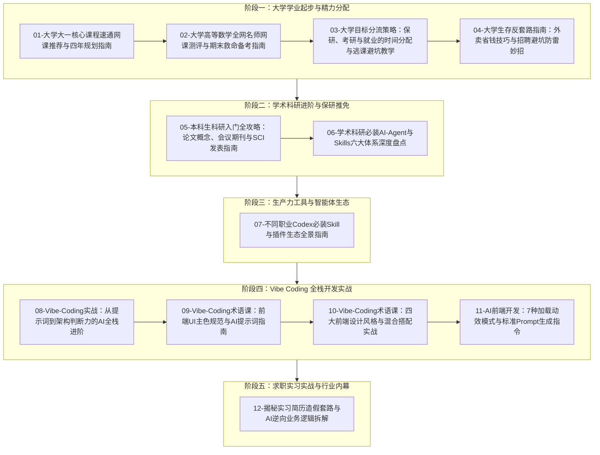

# 🧭 261022 视频资源库全景导读与建议观看顺序

## 资源库总览

本视频库收录了 12 个涵盖**大学学业成长、高等数学通关、精力分配策略、校园与求职反套路、学术科研入门、AI Agent 工具链、Vibe Coding 全栈开发以及前端 UI 规范**的高价值视频。

全部视频已按照其内容核心主旨完成中文标准化重命名，并为每个视频提取并沉淀了专属的详细 Markdown 笔记（同名 `.md` 文件）。

---

## 建议观看顺序与学习路线图

本套视频知识密度高，涵盖从大一新生入学、专业课通关，到科研进组、AI 工具流进阶，再到求职实战的全流程。建议按照以下**五大递进阶段**进行系统学习：

---

## 五大阶段深度导读与观看价值

### 阶段一：大学学业起步与精力管理（01 ~ 04）
- **核心目标**：平稳度过大一迷茫期，选对优质网课打牢基础，根据保研/考研/就业目标科学取舍精力，掌握校园生活与兼职防坑常识。
1. **[01-大学大一核心课程速通网课推荐与四年规划指南](<261022/01-大学大一核心课程速通网课推荐与四年规划指南.md>)** (03:09)
   - **必看理由**：建立大学大一高数、线代、四六级、大物、单片机、C语言、电路等全科通关视野，明确“以终为始”的四年路线。
2. **[02-大学高等数学全网名师网课测评与期末救命备考指南](<261022/02-大学高等数学全网名师网课测评与期末救命备考指南.md>)** (02:26)
   - **必看理由**：深度横向测评宋浩、孔祥仁、一高数、李天意、框框及猴博士等六大名师，根据自身水平在开学打基础或期末救命中做出最优选课。
3. **[03-大学目标分流策略：保研、考研与就业的时间分配与逃课避坑教学](<261022/03-大学目标分流策略：保研、考研与就业的时间分配与逃课避坑教学.md>)** (00:32)
   - **必看理由**：从大厂工程师视角拆解保研（小逃）、考研（中逃）与就业（大逃）在出勤与精力分配上的战略权衡。
4. **[04-大学生存反套路指南：外卖省钱技巧与招聘避坑防雷妙招](<261022/04-大学生存反套路指南：外卖省钱技巧与招聘避坑防雷妙招.md>)** (00:56)
   - **必看理由**：掌握外卖平台异地定位神券机制与聚餐返佣技巧，学会用“无简历小号浏览法”识别空壳公司招聘陷阱。

---

### 阶段二：学术科研进阶与保研推免（05 ~ 06）
- **核心目标**：从零建立学术科研认知，看懂论文、期刊、会议与分区指标，掌握利用 AI Agent 加速文献调研与论文撰写的完整工具链。
5. **[05-本科生科研入门全攻略：论文概念、会议期刊与SCI发表指南](<261022/05-本科生科研入门全攻略：论文概念、会议期刊与SCI发表指南.md>)** (10:00)
   - **必看理由**：10 分钟超详细硬核科研通识课，辨析论文与期刊、综述与研究论文，剖析学术会议三大优势、SCI/CCF 索引机制与好论文三大金标准。
6. **[06-学术科研必装AI-Agent与Skills六大体系深度盘点](<261022/06-学术科研必装AI-Agent与Skills六大体系深度盘点.md>)** (01:46)
   - **必看理由**：全景梳理 ARIS、Supervisor-Skills、AERS、学术绘图与 Nature 规范等六大高价值科研技能库，给学术研究装备最强外挂。

---

### 阶段三：生产力工具与智能体生态（07）
- **核心目标**：掌握现代 AI 编程智能体的扩展生态，用开箱即用的插件武装各项日常与专业任务。
7. **[07-不同职业Codex必装Skill与插件生态全景指南](<261022/07-不同职业Codex必装Skill与插件生态全景指南.md>)** (01:05)
   - **必看理由**：掌握 BrowserSkill、Computer Use 与 Analytics 通用三件套，以及设计岗 UIUX Pro Max、音视频 OmniVoice + HeyGen、电商 Record & Replay 与 Office CLI 自动化工具。

---

### 阶段四：Vibe Coding 全栈开发实战（08 ~ 11）
- **核心目标**：完成从“代码语法死记”到“架构判断力与精准下发指令”的范式跃迁，系统掌握现代前端 UI 的色彩规范、四大设计风格与 7 种加载动效模式。
8. **[08-Vibe-Coding实战：从提示词到架构判断力的AI全栈进阶](<261022/08-Vibe-Coding实战：从提示词到架构判断力的AI全栈进阶.md>)** (12:01)
   - **必看理由**：核心必看的 12 分钟认知大课。从谷歌 75% AI 生成代码与 METR 权威实验出发，深刻理解开发者三大核心能力（说得准、看得懂、管得住）与工程底线。
9. **[09-Vibe-Coding术语课：前端UI主色规范与AI提示词指南](<261022/09-Vibe-Coding术语课：前端UI主色规范与AI提示词指南.md>)** (05:02)
   - **必看理由**：彻底解决“AI 写的前端很丑”的问题，掌握 Primary Color 的视觉层级、操作区分与“选色给条件，用色给结论”的标准沟通公式。
10. **[10-Vibe-Coding术语课：四大前端设计风格与混合搭配实战](<261022/10-Vibe-Coding术语课：四大前端设计风格与混合搭配实战.md>)** (06:24)
    - **必看理由**：深度拆解扁平化、拟物化、新拟物与毛玻璃四大主流风格，传授“80% 扁平化主导 + 20% 局部毛玻璃点缀”的工业级设计架构。
11. **[11-AI前端开发：7种加载动效模式与标准Prompt生成指令](<261022/11-AI前端开发：7种加载动效模式与标准Prompt生成指令.md>)** (01:07)
    - **必看理由**：告别模糊的“做个加载动画”，掌握 Spinner、Progress Bar、Skeleton、Shimmer、Button Loading 等 7 种动效模式与现成 Prompt 模板。

---

### 阶段五：求职实习实战与行业内幕（12）
- **核心目标**：看清当前校招与实习市场的残酷乱象与造假黑产，学会用正向的方法提升业务理解力，守住诚信底线。
12. **[12-揭秘实习简历造假套路与AI逆向业务逻辑拆解](<261022/12-揭秘实习简历造假套路与AI逆向业务逻辑拆解.md>)** (00:30)
    - **必看理由**：揭密从岗位职责提取、AI 模拟对答，到研报数据逆向的流水线套路，警示职业道德与严格背调风险。

---

## 视频文件与详细笔记速查索引表

| 序号 | 视频文件名 | 详细笔记 Markdown | 视频时长 | 核心涉及关键词 |
| :---: | :--- | :--- | :---: | :--- |
| **01** | `01-大学大一核心课程速通网课推荐与四年规划指南.mp4` | [01-笔记](<261022/01-大学大一核心课程速通网课推荐与四年规划指南.md>) | 03:09 | 宋浩高数、线代本质、瑞斯拜四六级、STM32、以终为始四年规划 |
| **02** | `02-大学高等数学全网名师网课测评与期末救命备考指南.mp4` | [02-笔记](<261022/02-大学高等数学全网名师网课测评与期末救命备考指南.md>) | 02:26 | 宋浩、孔祥仁课后习题、一高数速通、李天意、框框老师、猴博士 |
| **03** | `03-大学目标分流策略：保研、考研与就业的时间分配与逃课避坑教学.mp4` | [03-笔记](<261022/03-大学目标分流策略：保研、考研与就业的时间分配与逃课避坑教学.md>) | 00:32 | 保研小逃、考研中逃、就业大逃、平时分与考勤管理、精力分配 |
| **04** | `04-大学生存反套路指南：外卖省钱技巧与招聘避坑防雷妙招.mp4` | [04-笔记](<261022/04-大学生存反套路指南：外卖省钱技巧与招聘避坑防雷妙招.md>) | 00:56 | 美团异地定位大额神券、抖音团购返佣、识别皮包招聘企业 |
| **05** | `05-本科生科研入门全攻略：论文概念、会议期刊与SCI发表指南.mp4` | [05-笔记](<261022/05-本科生科研入门全攻略：论文概念、会议期刊与SCI发表指南.md>) | 10:00 | 论文与期刊、综述 vs 研究、会议论文三大优势、SCI/CCF/JCR 分区、好论文标准 |
| **06** | `06-学术科研必装AI-Agent与Skills六大体系深度盘点.mp4` | [06-笔记](<261022/06-学术科研必装AI-Agent与Skills六大体系深度盘点.md>) | 01:46 | ARIS、Supervisor-Skills、PaperSpine、AERS、Nature Skills、Deep Research |
| **07** | `07-不同职业Codex必装Skill与插件生态全景指南.mp4` | [07-笔记](<261022/07-不同职业Codex必装Skill与插件生态全景指南.md>) | 01:05 | BrowserSkill、Computer Use、Analytics、UIUX Pro Max、OmniVoice、Office CLI |
| **08** | `08-Vibe-Coding实战：从提示词到架构判断力的AI全栈进阶.mp4` | [08-笔记](<261022/08-Vibe-Coding实战：从提示词到架构判断力的AI全栈进阶.md>) | 12:01 | 谷歌 75% AI 代码、METR 实验认知偏差、UI 术语表达、边界意识、产品思维 |
| **09** | `09-Vibe-Coding术语课：前端UI主色规范与AI提示词指南.mp4` | [09-笔记](<261022/09-Vibe-Coding术语课：前端UI主色规范与AI提示词指南.md>) | 05:02 | Primary Color、操作层级区分、品牌色与界面色分离、选色给条件用色给结论 |
| **10** | `10-Vibe-Coding术语课：四大前端设计风格与混合搭配实战.mp4` | [10-笔记](<261022/10-Vibe-Coding术语课：四大前端设计风格与混合搭配实战.md>) | 06:24 | 扁平化、拟物化、新拟物、毛玻璃 Glassmorphism、主导风格与局部点缀 |
| **11** | `11-AI前端开发：7种加载动效模式与标准Prompt生成指令.mp4` | [11-笔记](<261022/11-AI前端开发：7种加载动效模式与标准Prompt生成指令.md>) | 01:07 | Spinner、Progress Bar、Circular、Skeleton、Shimmer、Button Loading、Prompt 指令 |
| **12** | `12-揭秘实习简历造假套路与AI逆向业务逻辑拆解.mp4` | [12-笔记](<261022/12-揭秘实习简历造假套路与AI逆向业务逻辑拆解.md>) | 00:30 | 岗位 JD 拆解、AI 模拟对练、券商研报数据逆向、背景调查警示 |
