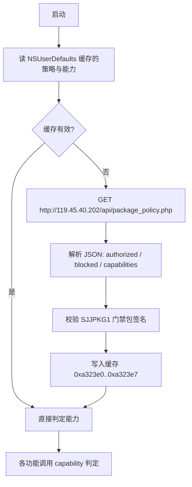

# 授权体系还原

## 组成



## 1. 策略请求

构造函数 `0x5e20`（18 条指令）：

```objc
// 还原自 0x5e20
NSString *url = [NSString stringWithFormat:@"http://%u.%u.%u.%u/api/%@",
                 119, 45, 40, 202, @"package_policy.php"];
```

立即数 `0x77 / 0x2d / 0x28 / 0xca`（119 / 45 / 40 / 202）按 varargs 顺序压栈，
格式串在 `0x0079c096`，路径在 `0x0079c0b0`，客户端版本串 `28.55` 在 `0x0079c0c3`。
请求头与 bundle 标识取自 `0x0079c0e1` 的 `bundle` 键。

响应体按 JSON 解析，消费的键：

| 键 | 含义 | 还原自 |
| --- | --- | --- |
| `authorized` | 是否放行 | CFString 0x95a200 |
| `blocked` | 是否封禁 | CFString 0x97b8e0 |
| `capabilities` | 允许的能力数组 | CFString 0x9a30c0 |
| `user_blocked` | 账号级封禁 | 0x79f8?? 区 |
| `update_offer` / `allowed` | 升级提示与兜底状态 | 0x79f8f6 区 |
| `app_id` / `bundle` | 应用标识 | CFString 0x9a3060 |

## 2. 门禁包

三个数据节：

```
__sjjprot  "SJJPROT|gate-lanes-v2|bootstrap=15|lane-chain=abc"
__sjjpkga  "SJJPKG1|slot=A|fp=99969dcc…|key=df147b58…|sig=QpMShu6o…|ver=1|end"
__sjjpkgb  "SJJPKG1|slot=B|…"
__sjjpkgc  "SJJPKG1|slot=C|…"
```

三槽 fp、key 相同、签名不同。校验封装在 `0x38d36c`：

```objc
// 还原自 0x38d36c，参数为 (keyHex, payload, signature)
BOOL verify(NSString *keyHex, NSData *payload, NSData *signature) {
    if (payload.length == 0 || keyHex.length == 0) return NO;
    NSData *der = hex_decode(keyHex);
    SecKeyRef key = SecKeyCreateWithData((__bridge CFDataRef)der, @{
        (id)kSecAttrKeyType: (id)kSecAttrKeyTypeRSA,
        (id)kSecAttrKeyClass: (id)kSecAttrKeyClassPublic,
    }, NULL);
    if (!key) return NO;
    if (!SecKeyIsAlgorithmSupported(key, kSecKeyOperationTypeVerify,
                                    kSecKeyAlgorithmRSASignatureMessagePKCS1v15SHA256)) return NO;
    return SecKeyVerifySignature(key,
                                 kSecKeyAlgorithmRSASignatureMessagePKCS1v15SHA256,
                                 (__bridge CFDataRef)payload,
                                 (__bridge CFDataRef)signature, NULL);
}
```

调用它的三处分别是 `0x38b2f4`、`0x38cc08`、`0x38dac8`，对应 slot A/B/C；
另有 `0x379cfc` 直接尾调用 `SecKeyVerifySignature`（`0x379d98` 的 `b 0x658d34`）。
签名载荷是去掉 `|sig=…|end` 后的 `SJJPKG1|slot=…|fp=…|key=…|ver=1` 前缀串。

注意：该链路校验的是策略包，不覆盖 dylib 代码段，所以改代码不会破坏它。

## 3. 能力判定

`0x3797f4`，4012 个方法里 15 处调用，是全部功能开关的唯一入口：

```objc
// 还原自 0x3797f4（88 条指令）
BOOL SJJCapabilityAllowed(NSDictionary *claims, NSString *capability) {
    if (capability.length == 0) return NO;                       // 0x379838
    if (![claims[@"authorized"] boolValue]) return NO;           // 0x379840 / 0x379860
    if ([claims[@"blocked"] boolValue]) return NO;               // 0x379864 / 0x379898
    id list = claims[@"capabilities"];                           // 0x3798ac
    if (![list isKindOfClass:NSArray.class]) list = @[];
    return [list containsObject:capability];                     // 0x379920
}
```

三条返回路径汇聚在 `0x37993c`，这是唯一需要改写的落点。

调用点与能力键：

| 调用点 | 能力键 | 场景 |
| --- | --- | --- |
| 0x4efc、0x4f50 | 由上下文传入 | 策略状态刷新与缓存写入 |
| 0x52a8 | — | 面板可用性 |
| 0xbdd88、0xbe020 | — | 授权文案与授权页 |
| 0x12da14 | — | beta 通道提醒 |
| 0x155094、0x1551b8、0x156994 | `token` / `claims` | 功能令牌 |
| 0x157c3c、0x16fd90 | `svip` | SVIP 专属能力 |
| 0x1fa4a8、0x2a41f8 | — | 媒体与工具入口 |
| 0x375c38 | — | 策略状态机 |

## 4. 缓存与状态机

`0x4be0`（305 条指令）在策略刷新后写入 8 个标志字节：

```
0xa323e0  授权总开关
0xa323e1  capability 判定结果（strb w0 from 0x3797f4 @ 0x4f58）
0xa323e2  封禁标记
0xa323e3..0xa323e7  子状态（更新提示、beta、报告去重等）
```

持久化键在 `__cstring` 里：`sjj_remote_svip_active`、`sjj_remote_svip_revoked`、
`sjj_remote_svip_receipt`、`sjj_remote_svip_plan`、`sjj_remote_svip_expires_at`、
`sjj_svip_unlocked_cached_user`、`sjj_svip_state_version`、`sjj_remote_beta_requires_svip`、
`sjj_package_policy_token_%@`、`sjj_package_block_ticket_%@`。

## 5. 与授权码（卡密）的关系

面板侧还有一套人工授权流程：`pasteAuthCode`（0xbd474）、`generateAuthCodeForUser`（0xbd924）、
`copyDeviceCode`（0xbd940）、`manualAuthInput`（0xbda00）、`showGeneratedAuthCode:`（0xbd7bc）、
`contactAuthorQQ`（0xbd294）。设备码由本机标识派生后提交给作者侧换绑，
结果仍以策略能力数组的形式回流到同一个判定函数——所以绕过 `0x3797f4` 后，
卡密、封禁、到期三种状态都不再影响功能可用性。

## 6. 绕过落点

```
0x37993c  e0 03 16 aa  mov x0, x22     →  20 00 80 d2  mov x0, #1
```

所有判定分支（含 capability 为空、未授权、被封禁）都在此收敛，改写后统一返回真。
